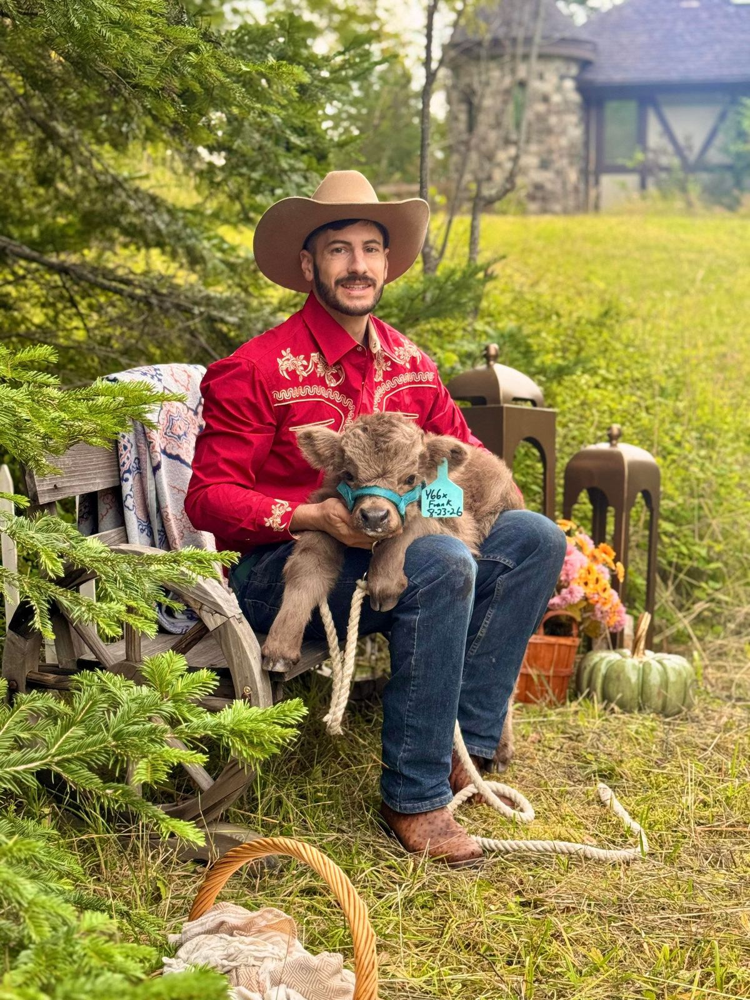
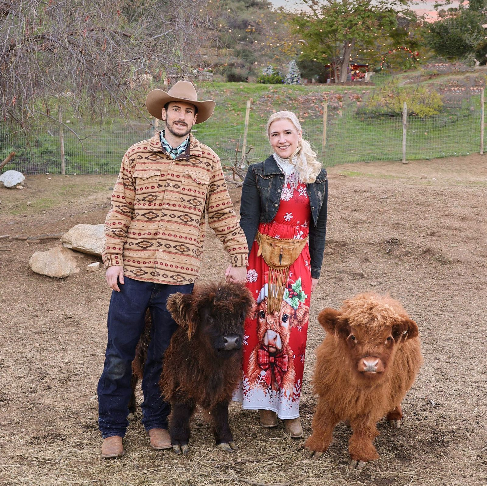

# Our Story

Howe Ranch is a private, family-owned boutique animal farm destination set in a storybook alpine setting in the foothills east of Kalispell, Montana, with sweeping valley views, towering evergreens and a glacier-fed creek winding through the property. Centered around miniature Highland cows and beloved barnyard animals, Howe Ranch offers intimate, advance-reservation experiences, farm stays, seasonal events, weddings and celebrations… all thoughtfully designed around connection, old-world hospitality and creating the kind of joyful moments families carry with them for a lifetime. The Howe Ranch experience has welcomed guests for more than five years, building on more than 25 years of the family creating magical guest spaces, seasonal traditions and warm hospitality for thousands of guests.

---

## Meet the Family Behind Howe Ranch

Around the ranch, Spencer is better known as “Farmer Howe.” Originally from Kansas City, Missouri, he is a United States Marine Corps veteran, having served at Camp Lejeune in North Carolina and Camp Pendleton in California. A lifelong hands-on, blue-collar kind of guy, Spencer has been a sought-after diesel mechanic since beginning his military service in 2014 and has continued serving the communities he has called home through civil service. Spencer also owns and operates Howe Digital Systems, offering software and website solutions. 

The family behind Howe Ranch brings together roots stretching from the American Midwest to Europe, with Bixi having grown up in five countries. The ranch is very much a reflection of the two of them: Spencer’s hands-on nature and love of building and caring for the livestock and property, and Bixi’s lifelong background in hospitality, her almost uncanny connection with animals, and her eye for designing the immersive spaces and little details that create so much of the Howe Ranch magic. 

Over the years, Howe Ranch has grown into something much bigger than a farm filled with deeply loved—and thoroughly spoiled—animals. Its character has been built from years of collected pieces, traditions, handmade details and treasured finds, carried from one home and community to the next. Each chapter has added another layer to the story guests experience today. 

And Howe Ranch has never been built by just two people. Family and friends have supported the farm throughout its journey, lending their talents, time and enthusiasm to a mission they believed in—and, admittedly, falling in love with the tiny cows and the rest of the ranch family along the way. 

Through every chapter, the heart of Howe Ranch has remained the same: giving people a place to slow down, connect and experience something joyful together. Those traditions, animals and experiences have now been shared with thousands of guests, and today the story continues in the mountains of Northwest Montana.

