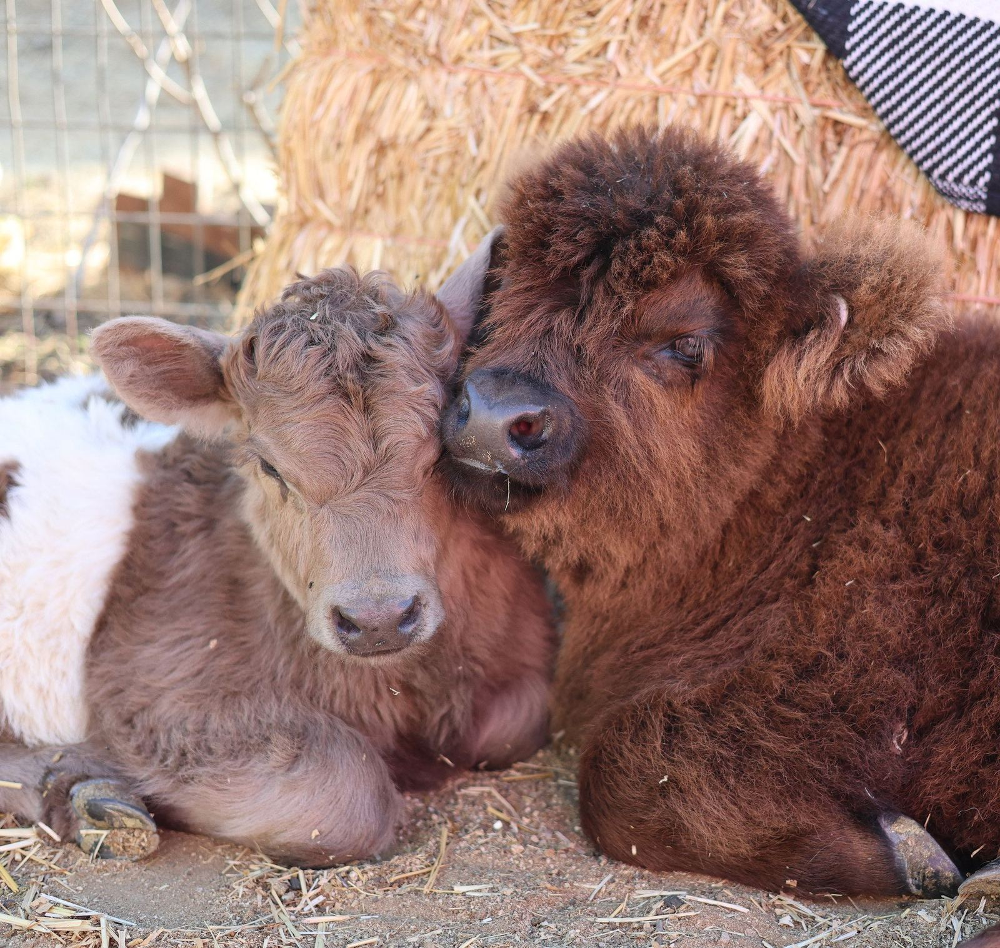

---

# Meet the Howe Ranch Herd

### About our Micro/Mini Highland Cows:

<a class="button" href="/animals/availableminimoos">Available Mini Moos</a>
<a class="button" href="/_files/ugd/fca21d_e0957eb558e04e4f82a17c279e8a48ea.pdf">Mini Highland Cows</a>
<a class="button" href="/_files/ugd/fca21d_d8d93495d6b34d4d93eb3438296a6179.pdf">Embryo Transfer Program</a>
<a class="button" href="/_files/ugd/fca21d_b6ce80bacc9a4eb287a3384f9d7ac558.pdf">Baby Moos</a>

### About our other farm ambassadors:

<a class="button" href="/_files/ugd/fca21d_1283cb9dc58144eaa12b779a964c101d.pdf">Goats</a>
<a class="button" href="/_files/ugd/fca21d_6cf53d135d0d4c40a722fda81db21331.pdf">Emus</a>
<a class="button" href="https://a-z-animals.com/animals/rabbit/the-10-most-adorable-lop-eared-rabbit-breeds/">Rabbits</a>
<a class="button" href="https://en.wikipedia.org/wiki/Valais_Blacknose">Sheep</a>

### And our flock:

<a class="button" href="/_files/ugd/fca21d_48b3fe3a69dc4dda92dbc98b9ea12ffe.pdf">Donkeys</a>
<a class="button" href="/_files/ugd/fca21d_c29aa780e7c946d39611734cacf00703.pdf">Ducks</a>
<a class="button" href="/_files/ugd/fca21d_c3d4cca13f2241d6b68ea7cd28a68eb4.pdf">Chickens</a>

---

## Questions?
