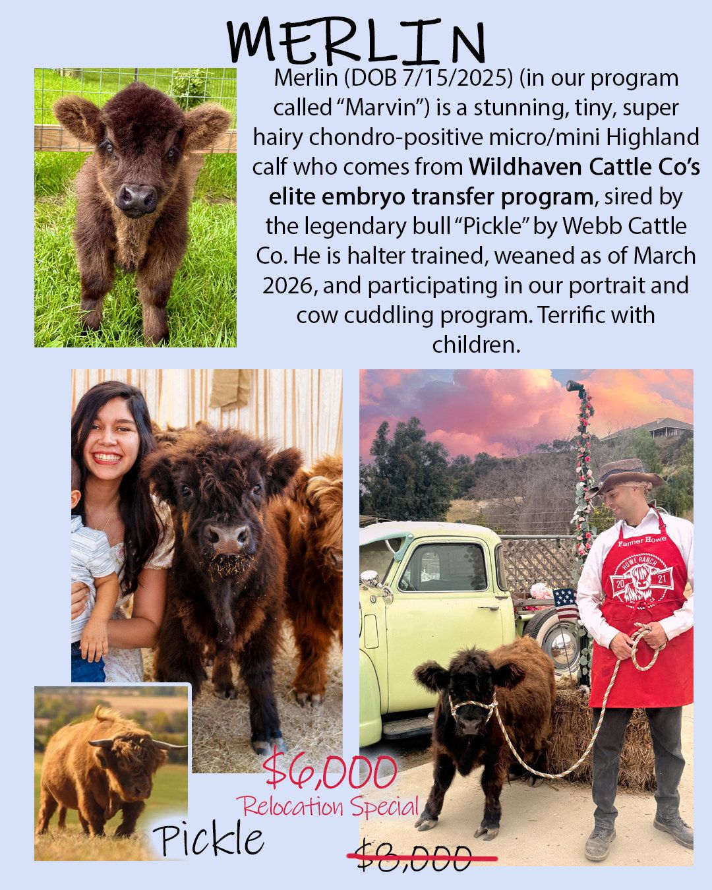
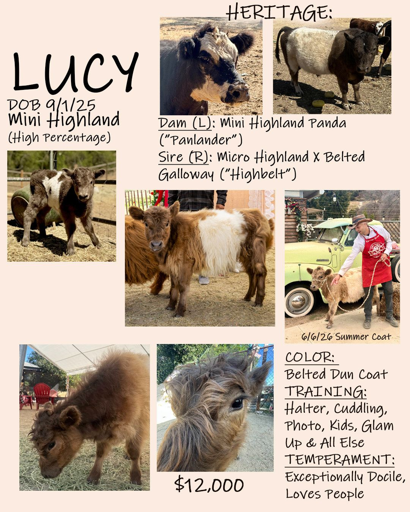
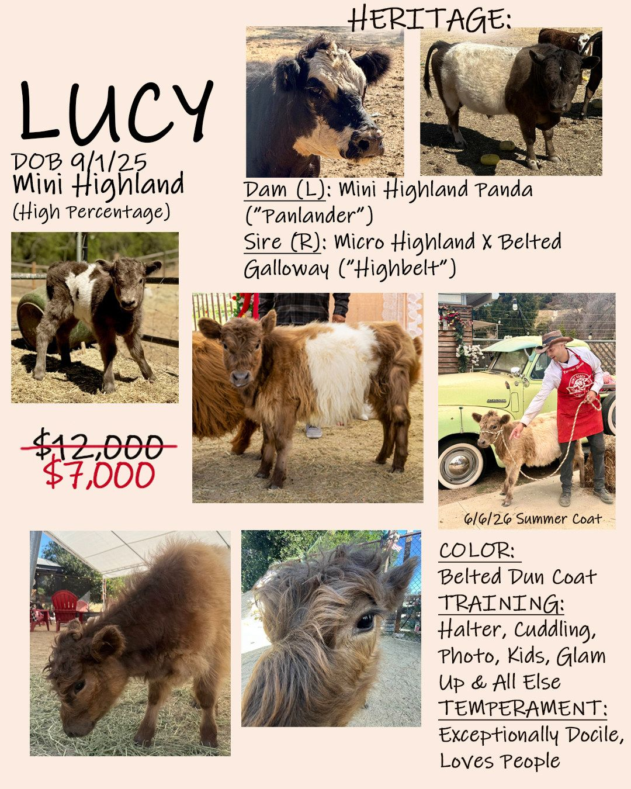
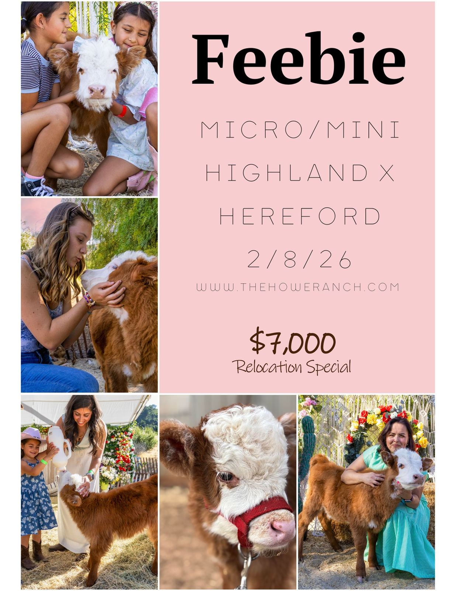
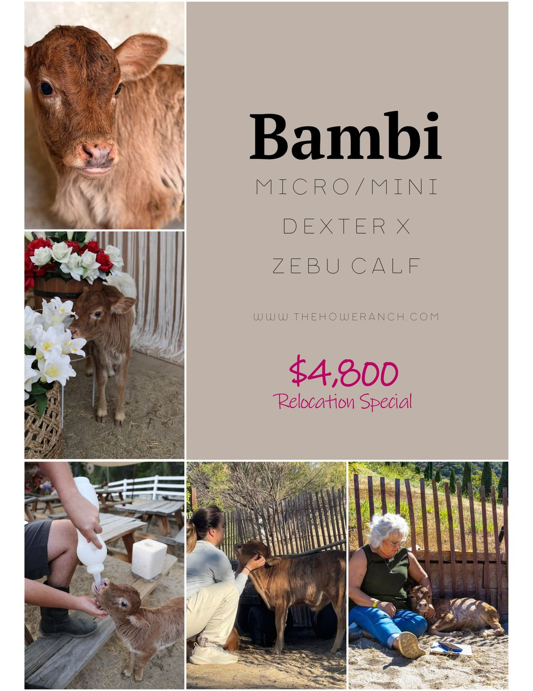
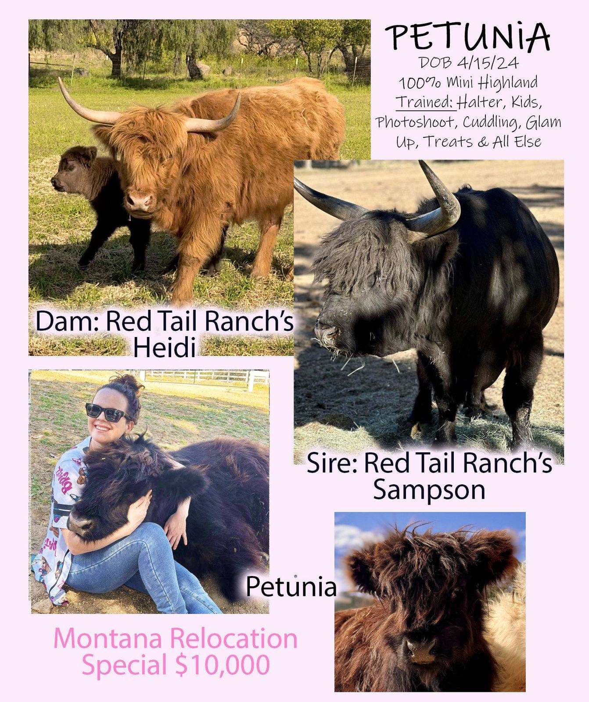
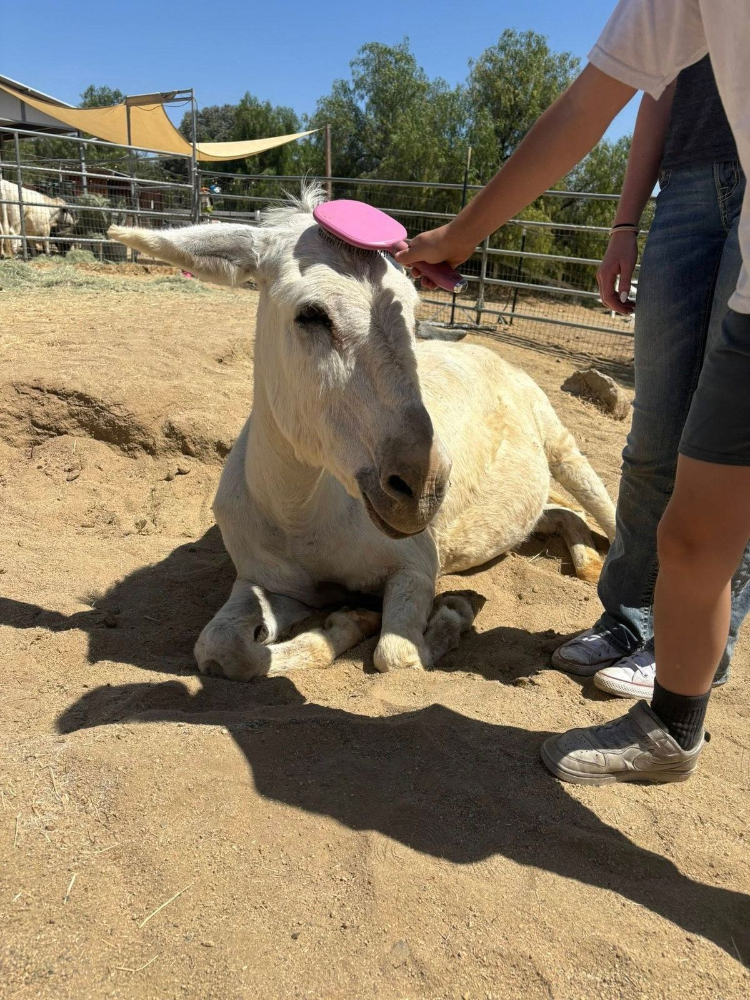

# Available Mini Moos

Micro & mini Highland lovers — this is the kind of opportunity people wait years for.

A very limited number of our most beloved, program-raised animals are now available for carefully selected farms, retreat properties, therapy programs, agritourism experiences, and exceptional private homes.

These are not ordinary farm animals — these are the animals people travel to meet.

Please note: Micro and miniature Highlands are luxury livestock, and exceptional animals in this market carry significant value. Our own herd includes select cows with individual market values exceeding $50,000.

The animals currently available from Howe Ranch are highly handled, program-raised animals with extensive daily socialization, halter training, guest interaction, photo experience, and calm, people-oriented temperaments. Their placement reflects the real market for quality micro and miniature Highlands, as well as the time, training, care, and investment that has gone into raising them.

---

## Merlin 

SOLD

Chondro-Positive Embryo-Transfer 100% Highland Yearling

Bottle Raised; Polled

31 '' @ 12 Months

[Photo Gallery](https://photos.app.goo.gl/SRgEHMTLyyaiDdU56)

Relocation Special! $6,000

11-month-old micro/mini chondro-positive Highland steer calf, out of the legendary bull Pickle from Webb Cattle Co. and conceived through Wildhaven’s superb Embryo Transfer Program. Extremely docile, fluffy, halter trained, loves brushing, and one of the gentlest little cow-cuddlers we have ever raised. Does not even nudge for alfalfa cookies! Green eyes, heavy coat even in the hot SoCal heat. Excellent fit for agritourism, therapy, photography, emotional support, or a bull companion. Black with pronounced deep red-brown shading. ~31" Special: $6,000. (see album with live measuring)

---

## Lucy 

SOLD

Chondro-Negative

Bottle Raised; Polled

33 '' @ 10 Months

[Photo Gallery](https://photos.app.goo.gl/cLkULrMgAmuz9Nqn6)

Relocation Special! $7,000

10-month-old mini Highland x Belted Scottish Galloway heifer bred to achieve rare dun coloring with white markings. Fluffy, extremely docile, halter trained, and regularly featured in photo shoots, cow cuddling, glam-up, brushing, and hands on kids interaction. DOB 9/1/25, ~ 33" (see album with live measuring)

---

## Feebie 

SOLD

Chondro-Not Tested

Bottle Raised; Horned

~27'' @ 5 Months

[Photo Gallery](https://photos.app.goo.gl/LuTasUYSS2DVX4cX9)

$7,000 Relocation Special!

Micro/Mini sized Highford calf alert! We have this sweet, very hairy and tiny micro/mini halter-trained girl. Horned with Highland fluff and the signature Hereford mask. Incredibly sweet heifer born 2/8/26, on the bottle.

Microchipped, up to date on shots (black leg and bovine respiratory), wormed, and with a health certificate.

Was around 18’’ at birth. Her dam is a 35” micro mini-Hereford and sire is a 39” yellow mini highland (photos of parents in her album). Both of her full sisters are micro minis.

Incredibly docile, beautiful temperament, seeks human attention, will nap in your lap, and request chin scratches. She is halter trained and has served in hundreds of photoshoots and cuddling sessions in her short life already.

---

## Bambi 

SOLD

Chondro-Not Tested

On the Bottle; Polled

~26'' @ 5 Months

[Photo Gallery](https://photos.app.goo.gl/yqwrvXn1XUot1JVg7)

$4,800 Relocation Special

Bambi is a truly special micro mini Dexter/Zebu cross baby steer with the sweetest personality and the softest brindle coat. Born February 8, 2026, Bambi has quickly become one of our most beloved little farm ambassadors.

With his gentle baby-deer look, Bambi absolutely lives up to his name. He works daily in our photo shoots, cow-cuddling experiences, and kids’ programs, where his calm nature and adorable appearance make him an instant crowd favorite.

Bambi is halter trained, treat trained, loves brushing and massages, and completely people-oriented. He is sweet, gentle, and easy to love, making him a wonderful fit for an agritourism program, emotional-support setting, companion miniature cow home, or family farm looking for a truly memorable little steer with a big heart.

---

Petunia 

SOLD

Chondro-Negative

Bottle Raised; Disbudded

41" @ 2.5 Years

[Photo Gallery](https://photos.app.goo.gl/XQjCsaLwF2oQmCQt7)

$10,000

100% Highland mini heifer, out of Red Tail Ranch’s Heidi x Sampson. Super hairy, sweet, people-oriented, halter trained, and one of our most beloved cow-cuddling/photo-shoot girls. She has been raised in our visitor program with extensive daily handling and is ready to become part of a breeding program. Gives kisses on command. Moos when prompted. Black with pronounced deep red-brown shading on half her body.~ 2.5 YO, ~41", ready to be bred (see album with live measuring done 6.6.26)

---

Annie & Elsie 

RETAINED 

Mother-Daugher Jenny Pair

Rare White Donkey

8 & 18

[Photo Gallery](https://photos.app.goo.gl/v56c8WHScX7DV55q6)

Bonded pair of pure white donkeys, ages 8 (Annie) and 18 (Elsie, mother), with extensive experience in public-facing farm settings. Both are calm, friendly, and accustomed to daily petting, brushing, photo sessions, and interaction with children and adults. Their guest routine involves meditating on guests’ shoulders. 

They work comfortably in active farm environments and have proven livestock-protection awareness while remaining exceptionally gentle with guests. Their striking white color photographs beautifully and has made them a favorite for events and agritourism settings. 

Well handled, routine-oriented, and reliable. Placement together required. Serious inquiries only. 

The two white donkeys are available for $4,500 as a pair only.

