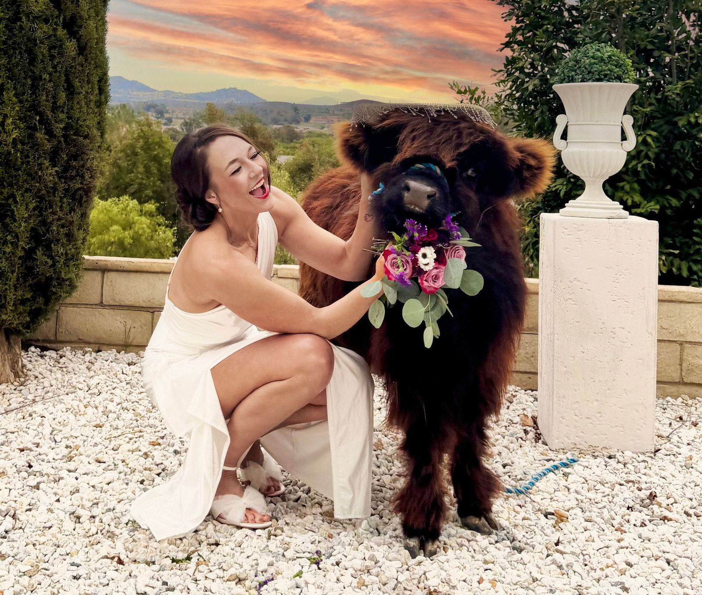

# Howe Ranch Venue Reservation \*Checklist\*

---

By reaching out to us you confirm that you have read through the following

Checklist (1. - 11.), agree with the venue guidelines below and [venue policies](/_files/ugd/fca21d_b3646e5a5ec9407a829c5cf5f740f7c5.pdf).

1\. OUR COMMITMENT TO EXCELLENCE:

At Howe Ranch, we maintain a beautiful venue and care for over 35 farm animals year-round to ensure an exceptional experience for your event. Our pricing reflects the quality and built-in services we offer and is firm. We invite you to explore booking opportunities on [Peerspace](https://www.peerspace.com/pages/listings/647423c524653c000e5d50e2?utm_source=copy_link&utm_campaign=listing_sharing)[ by entering your event date, guest count, and timing. Please note: packages are fixed; removing included items or areas will not reduce the rental fee.](https://www.peerspace.com/pages/listings/647423c524653c000e5d50e2?utm_source=copy_link&utm_campaign=listing_sharing)

2\. BEFORE CONTACTING US, WE ASK THAT YOU:

Before contacting us, we ask you to calculate your booking cost, which includes insurance, venue, and service fees: [Mini Moo Express Gathering](/mini-moo-express) or [Enchanted Matinee Package](/_files/ugd/fca21d_000212d4833040929b7a9d0a22ccaca7.docx). We aim to assist with queries not already addressed in our provided information to ensure your planning process is seamless.

3\. VENUE CONDUCT GUIDELINES

Sound Levels: If you plan to include amplified sound in your gathering, this must be disclosed during your booking inquiry. The atmosphere at our venue is intended to be lively yet suitable for a farm setting. To ensure the comfort of all guests and the wellbeing of our animal residents, moderate sound levels must be maintained throughout the event. Loud or high-energy music that could disturb our animals or the surrounding environment is strictly prohibited. Sound cannot be heard outside of the contracted venue/area, and not at all past 9:00 PM., which is when all activities must conclude. The sound is monitored electronically and by security. If guests choose to hire a DJ, the intent must be shared with the venue and written into the contract at the establishment of the contract. [Security services](/_files/ugd/fca21d_fb838f8775dd4e79b5fd5d2662a29c58.pdf) must be contracted through Howe Ranch for the duration of the set. Guests must be notified by client of conduct guidelines. \* 

Speed Limit & Parking Compliance: Every visitor to Howe Ranch must commit to the Zero Impact on the Neighborhood & City policy. The private road leading to the farm venue serves as a trail for farm animals and is adjacent to the neighboring farms' pastures and farmhouses, thus subject to constant monitoring and regulatory scrutiny. All guests and service providers must adhere to a 15-mph speed limit while on this road. Nobody is allowed to park on the private street or on a neighboring farm's property. Failure to comply with this speed limit and/or parking policy is a serious violation that could lead to the immediate shutdown of the event.

Private Event Clause: Howe Ranch is committed to ensuring a safe and enjoyable environment, thus only private events with personally invited friends and family by the host are permitted. Public events, influencer parties, and events with guests unknown to the host are strictly prohibited. Hosts must submit a guest list for approval prior to the event, detailing the relationship between the host and each attendee. Failure to adhere to these conditions will result in immediate event cancellation and will lead to forfeiture of any deposits or fees paid, in accordance with our standard cancellation policy.

4\. PROFESSIONAL EXPECTATIONS:

We value timely responses and professional communication, which are crucial given our daily commitments. We reserve the right to adjust our service or communication if these standards are not met. Inquires will be kept active for 72 hours.

5\. OUTDOOR SPACES HIGHLIGHTS:

Our customizable outdoor spaces include multiple areas like the Valley View Terrasse, the Highland Vista, the Sunset Sanctuary with a large pool and cabanas, the Plaza, and the Barn Courtyard with a 45 x 80 ft space with sand footing. Our large multi-use areas on concrete accommodate diverse events for banquets and other. Event essentials such as tables (8 ft rectangular wood banquet tables, not round or other tables) and chairs (rustic metal and wood chairs or white wooden banquet chairs) are free for events with 50+ guests and/or booked for 6+ hours of hosting (not including set up and break down) and available at a low cost for smaller/shorter gatherings.

6\. HOW TO TOUR HOWE RANCH:

Prior to requesting a Site Tour you must acknowledge and accept our venue pricing and venue guidelines (links above), as neither are negotiable. Must have approved event budget for either tour option:

1\. Request a free guided virtual site tour by text message 951-219-4212

2\. Request an in-person [farm tour ($250 for up to 5 guests):](mailto:spencerahowe99@gmail.com?subject=Private%20Tour%20Inquiry) fully credited toward event booking) and sign the waiver. You can also explore already offered Open Farm Days ($30 pass) by going to our calendar at [The Howe Ranch (thehoweranchpayment.com)](https://thehoweranchregistration.com/)[. ](https://thehoweranchregistration.com/)

Liability Disclaimer: We cannot offer in person site tours without registration & waiver. No exceptions. The farm is not open to the public outside of scheduled visits/events. 

7\. TYPES OF EVENTS:

You can host gatherings of the nature of staff retreat, farm tour, farm experience, farm animal encounter, yoga with goats, Military retirement ceremony, yoga & wellness retreat, photo shoot with farm animals or with rural backdrop, graduation party, bar mitzvah, proposal, bridal shower, film shoot, birthday party, commitment ceremony, baby shower, gender reveal party, coming out party, Quinceanera, family reunion, company holiday party, celebration of life, or an ad hoc dinner party with the book club.

Note:

\- For your Wedding/Elopement Party, visit our [Wedding Page](/weddings) and [Wedding Event Listing](https://www.peerspace.com/pages/listings/647591b224653c000e5d878f?utm_source=copy_link&utm_campaign=listing_sharing).

\- Sound must is restricted to the outdoor space you rent with an 85 db limit that is monitored due to the venue being on an animal farm and being surrounded by animal farms.

8\. VENUE FEE EXCLUSIONS:

Prior to booking, clients/guests must acknowledge:

• Vendors, hosts, staff are not permitted onsite outside of venue rental timeframe.

• Clients are not permitted to coordinate vendors without review and approval.

• All vendors, décor, and services must be finalized 14 days before the event.

9\. OUTDOOR VENUE DETAILS:

Howe Ranch is situated in the exquisite, rural foothill community of Wildomar Estates, which is adjacent to Bear Creek golf course and La Cresta in the Temecula Valley/Santa Rosa Plateau area, conveniently located just three minutes from the I-15 freeway. The owners have over the past three years created a unique event space that effortlessly combines rustic beauty and natural elegance for the most memorable events, while promoting unforgettable visual and hands-on experiences, affordability and a fun, luxurious and safe environment for adults and kids alike.

Nestled in a picturesque rural location, our venue boasts panoramic mountain and city views, and an abundance of unique settings throughout the ~ four-acre property. The ranch is home to a growing herd of farm animals, including mini cows from Scotland and Australia, white Austrian Baroque donkeys, three breeds of mini goats, ducks, chickens, and lop bunnies. A guided farm animal encounter is included in most event bookings.

A. The Highland Vista:

This space has hosted private ceremonies, live music, our "Harvest Retreat" fall festival, the annual Christmas market and Winter Wonderland, and Summerfest with public servants who work in emergency response and disaster; baby showers, petting zoo, and team building events with stunning views of Temecula Valley and Palomar Mountain. Enjoy stunning views from this area, which also features a multi-use concession stand and two natural ceremony arches and backdrops. Guests arrive via a meandering path walking through a carefully curated garden, adorned with blooming flowers, lush foliage, and mature trees. The gentle whispers of a fountain accompany your footsteps, creating a soothing melody that harmonizes with the soft rustling of leaves.

B. The Sunset Sanctuary and the Plaza:

This venue has hosted hundreds of guests since we restored the property to a modern farmstead in 2021. You will enjoy complete privacy and panoramic views of four mountain ranges from Los Angeles to San Diego, and city lights from Temecula to Lake Elsinore.

The resort-style pool area is furnished with two large cabanas, lounge and dining spaces, plus a large adjacent concrete venue that can accommodate banquet tables and a dance floor for up to 150 guests. Included are a sitting area with a TV that features sports channels, a bar area, and a shower. Some of its add-on features are a club room, dedicated BBQ station, the club room, which can be rented as an add-on (pending availability). Kids love spending hours in the large pool, which features floaties, toys and lights at night. The soda bar has also been a big hit with our younger guests. On hot summer days, our adult guests love a themed bar, and the jacuzzi for 10 at night. For a corporate event, we recommend the rustic wine bar set up poolside. Please inquire ahead of time about Add-Ons such as bars and bar-tending service.

Adjacent is a large, concrete multipurpose venue that can accommodate banquets and a dance area for up to 150 guests, including an area for market stands, catering and a large dance area with optional PA system for events 50 guests +.

C. The Valley View Terrasse:

This venue is a large patio area furnished with rustic wine barrels and lined by Mediterranean hardscape and foliage. The venue overlooks the equestrian center, barns, adjacent pastures with livestock and the distant Temecula valley and mountain ranges. This space is ideal for dinner parties, sunset soirées and golden hour receptions.

D. The Barn Courtyard and Sand Pit - Available on select Sunday mornings

Features a large multi-purpose space for reception/dance floor use and 80 X 40 ft sand area that features picnic tables, games, and a fire pit. This is a popular space for birthday parties, petting zoo events, and large receptions with the rustic backdrop of the animal barn. Inquire about Sunday Venue Special at the Barn Area.

\* Farm Animal Encounter: Meet Petunia, Marylou, and Moolikooli, our Highland calves, Buttercup, or mini Scottish Galloway steer, Flint, our Australian lowline Angus calf, Wendy and Lilibeth the alpacas, Annie and Ms Elsie, the white Austrian Baroque Donkeys, and our herd of mini goats, plus the English Lop bunnies, our flock of friendly chickens of different breeds and four ducks. The farm offers a private petting zoo and Farm Animal Encounter, which can be included in your special event.

10\. LOST AND FOUND POLICY

At Howe Ranch, we cannot assume responsibility for personal items left behind.

Personal Responsibility: Guests are responsible for their belongings during their visit. 

End of Event: Ensure you have all your items before leaving. Left-behind items will not be stored or mailed. 

No Lost and Found: We do not maintain a lost and found service due to limited capacity. 

Final Collection: Items left behind will be discarded if not collected by the end of the event. Special pick-up times or mailing requests cannot be accommodated.

11\. ADDITIONAL VENUE GUIDELINES 

 

Parking On Site Only: Guests must park in the designated parking lots on the property, not on the private street or a neighbor's estate. If guests violate the parking rule, the gathering will be cancelled immediately. We can only offer gatherings if guests respect our neighborhood. 

 

Guests must not feed any of our livestock, unless an animal encounter is part of your booking, and the activity is supervised. You will receive the feed appropriate for the animals. Feeding the donkeys especially can lead to harm, choking death. Feeding the goats chicken feed will kill them. 

 

You must book time for set up and break down if you have any type of food service/decor/etc. planned. No member of your party is allowed on the premises before or after your booked time; No exceptions. The property gate is closed before and after your event time. We offer a set up or break down add on for events with 50+ guests. Max 60 minutes set up and max 60 minutes break down. 

 

Waiver and Conduct Guidelines: It is your responsibility to ensure that every visitor in your group acknowledges our [waiver](/_files/ugd/fca21d_25540bdb448e4387a9ed9bace59f96b9.pdf). It is your responsibility to enforce conduct guidelines and watch your children throughout the entire time of your booking to prevent event shut down. 

 

Restoration: Leave the area the way you found it (collect and remove toys, your decorations, balloons, decor waste etc.). Ensure that everything (furniture, decor, planters, etc.) is placed the way it was. If you do not stage the furniture the way it was at arrival or leave any non-consumables waste behind such as decor/props/balloons, you agree to pay a $150+ restoration fee. You will be billed for labor and time. 

 

Damage/Loss: If anything breaks during your stay, report it to the host right away and make arrangements for replacement. If your guests take something of ours, you are responsible for immediate replacement at three times the value for the inconvenience.

Food & Beverage 

Outside food and alcoholic beverages are not permitted on the property, with the exception of a celebratory cake. Select concessions, treats, and catering options are available through approved offerings. 

 

No drinking and zero drug policy enforced. If you plan to host a drinking party and or/420 party, our farm is not a suitable place for you. 

 

Waste Management: Ensure that food/drink related trash (consumables waste) is in the trash receptacles or bagged and closed. Food and waste must not be left out, anywhere. No decor-, bar-, and event other trash shall remain on the property, only consumables trash. Guest is responsible to remove all other related waste related to items brought by guest, including cardboard, packaging, bar bottles and boxes, garlands, pinatas, balloon arches, backdrops, props, etc.

Power and Electrical Guidelines for Vendors: If your event includes vendors with high-powered commercial equipment, such as concession stands with fryers or other cooking equipment, you must arrange for them to bring their own generators or power banks. Using our15-20 AMP outlets for high-powered devices can create fire hazards and cause power failures, which could disrupt your event, and is not permitted. 

 

Safety & Event Terms: We reserve the right to terminate an event agreement and cancel the event if the client fails to adhere to event contract terms or if the event is deemed to pose a risk to the Venue/attendees.

OTHER OPPORTUNITIES:

PRODUCTION:

In any of the outdoor locations. Inquire about availability.

WEDDINGS/RECEPTION:

See our page for [Wedding Events.](/weddings) Wedding bookings are Ceremony Only, Reception Only, and Ceremony and Reception, as well as Elopement Party and Micro Wedding.

<a class="button" href="https://thehoweranchregistration.com/">Private Mini Moo Experience</a>

