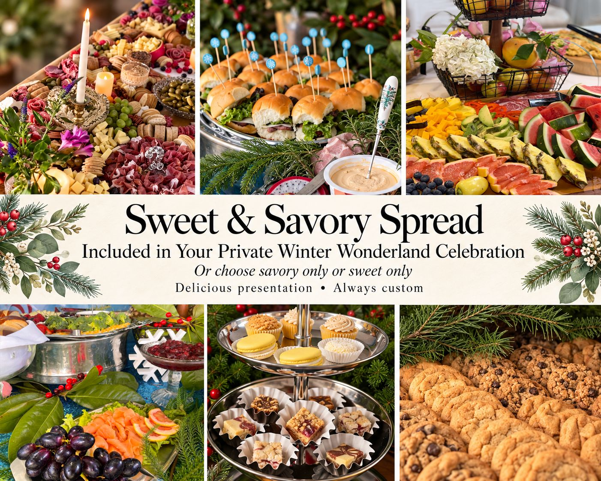
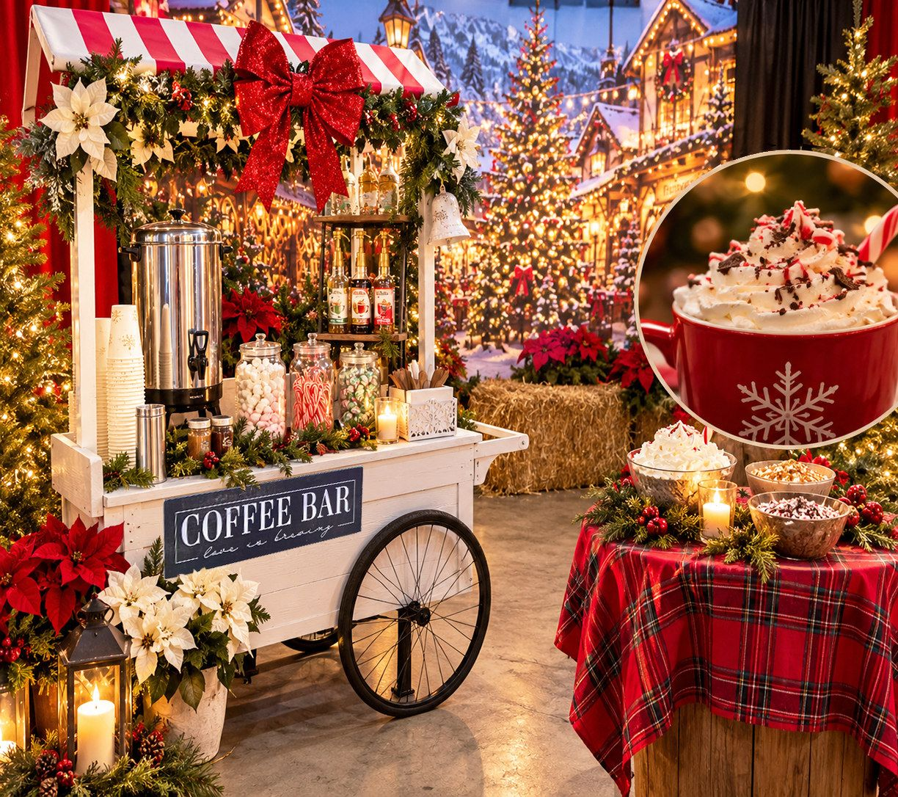

Private Winter Wonderland Celebrations

All - Inclusive, Immersive Holiday Experience

This holiday season, leave ordinary holiday gatherings behind and treat your group to something truly extraordinary! Now celebrating its 17th magical year, Howe Ranch's beloved Winter Wonderland invites families, friends, businesses, and organizations to step into a whimsical holiday world filled with unforgettable experiences, festive traditions, and a little storybook magic.

Imagine having your very own private Christmas village, inspired by the charm of European Christmas markets and brought to life with beautifully decorated spaces, enchanting themed worlds, festive treats, and cozy holiday cheer. From the whimsical Gingerbread Village and Santa's Workshop to the Frozen Kingdom, North Pole, Whoville, the Tinselwood Elf Village, and Candyland, every corner offers something wonderful to discover.

Cuddle adorable fluffy mini-Highland calves, meet our other sweet farm animals, follow a magical scavenger hunt through the Wonderland, and enjoy festive activities, delightful surprises, and picture-perfect moments. Gather around beautifully styled holiday tables, savor seasonal refreshments and our famous holidaze spread, and celebrate together in an atmosphere unlike any ordinary holiday party.

Whether you're planning a company holiday celebration, a festive family reunion, or a special gathering with friends, your private Winter Wonderland is designed to create memories that last long after the holidays.

Make this year's gathering the one they'll never forget!

🎄 Private Wonderland Celebration Season: December 1 – January 31 

In the new year, Winter Wonderland gradually transforms from Christmas magic into our enchanting Season of Love.

🎄 Dates already unavailable for Private Celebrations: December 6, 13, 20, 24 & 31

Explore the magic below and reserve your private celebration!

Scroll down for details...

<a class="button" href="https://photos.app.goo.gl/RvJ5Gzipc5mrAgnFA">Photos</a>

---

# Your Party Package:

---

---

### Farm Animal Encounter

Private Holiday Farm Animal Extravaganza with baby cow kisses and cuddles included. Delight in cuddling baby farm animals like mini Highland calves, curious goats, Annie the donkey, Dolly the emu, sweet lop bunnies, ducks, friendly chickens and more. Photo opportunities against 8 curated farm holiday backdrops.

### Eight Enchanting Areas

Reserve your spot now for our 17th annual Winter Wonderland at the ranch—an afternoon filled with warmth, joy, and a heap of seasonal magic that will bring your group closer together with five magical areas to explore - all included:

- Winter Wonderland Traditions: The hot drinks bar (hot chocolate or tea and apple cider) in our curated Christmas Market.
- Games and Activities: Foster team spirit with our winter-themed games and activities. From a traditional Scavenger Hunt to a trip to the miniature North Pole Village, your team can earn Wonderland bucks and win prizes you provide while enjoying the festive atmosphere.

### Charming Add Ons

Optional Add Ons to make your visit to Winter Wonderland extra special:

- Enchanted Holiday Character(S)
- Ornaments or Cookie Workshop with Mrs. Claus
- Santa Claus Visit
- And more (request menu)

<a class="button" href="/_files/ugd/fca21d_5211feb3620f4da8bb15164f1ed37c8e.pdf">Add Ons</a>

---

---

### Yuletide Banquet Setting

At the heart of our enchanting Grand Hall, beautifully appointed banquet tables create a cozy, festive gathering place reminiscent of a charming European Christmas market. Surrounded by twinkling trees, whimsical holiday displays, and the magic of our themed Christmas villages, your private entertaining space features seasonal linens, charming centerpieces, and thoughtful holiday touches. This inviting setting offers the perfect place to gather with family and friends, enjoy festive refreshments, celebrate special moments, and create lasting holiday memories together. For your comfort, our Grand Hall is heated as needed.

### A Delicious Holiday Spread

All included for any size gathering: Indulge in a beautifully presented holiday spread, thoughtfully arranged for your private celebration. Enjoy a delightful combination of sweet and savory favorites, from festive cookies, cupcakes, and dessert bars to an abundant charcuterie presentation featuring smoked meats, artisan cheeses, fresh fruits, nuts, crackers, and breads. Prefer an entirely sweet or savory selection? Your holiday spread can be tailored to either preference for your entire party, with the same festive charm and attention to presentation.

### A Cozy Christmas Market Beverage Experience

Warm up with a delightful selection of festive beverages, all included in your private Winter Wonderland celebration! Inspired by the charm of a traditional German Christmas market, our holiday drink stations feature rich German coffee, warm apple cider, creamy hot chocolate, and aromatic winter teas. Each is accompanied by an assortment of festive toppings, flavorful additions, and special holiday fixings, inviting guests to create their own cozy seasonal favorites. A delicious little touch of Christmas magic to sip and savor!

---

## Winter Wonderland Celebration

For Appreciation/Team Building/Holiday and other Parties up to 120 Guests. Note: Wedding celebrations of any kind (ceremony/reception/elopement) cannot be booked through the Winter Wonderland program.

The Group Experience includes:

1. One-on-One Time with the Baby Moos (micro mini Highland calves) & trained heritage livestock
1. Eight Magical Winter Wonderland Areas to Explore
1. Themed Sweets & Savory Spread
1. Hot Chocolate, Tea Time & Cider Bar in Christmas Market Station
1. Venue fee and staff facilitation
1. Scavenger Hunt with Prizes
1. Petting Zoo & Staff, Baby Highland Cow and Farm Animal Cuddling and Feeding
1. Access to Add Ons: Snow Cone Station, Enchanted Characters, Vocalist/Performer, Cookie Decorating or Ornament Making with Mrs Claus/Enchanted Character, Photo Booth
1. Onsite Parking
1. Restrooms, including ADA

Opportunities to Book:

· Weekday Events: Starting in December we offer exclusive weekday opportunities from 1:00 PM to 9:00 PM, and select Saturdays.\* Each event is available in 3 to 4-hour slots, depending on group size (3 hours up to 49 guests, 4 hours for 50+ guests). Coordinators have loved to offer it as a unique team-building experience.

· \*Select Saturdays: Inquire about availability.

Winter Wonderland Celebration Pricing

We will prepare your quote within 24 hours if all pertinent information is provided.

<a class="button gold" href="https://thehoweranchregistration.com/private-winter-wonderland">Request Your Date Online</a>
<a class="button" href="mailto:howeranchservices@gmail.com?subject=Private%20Winter%20Wonderland%20Celebration">BOOK</a>

FAQs

- Winter Wonderland is an experience, and everyone 1+ of age is considered a Guest due to liability and staffing requirements. All experiences include direct interactions with livestock.
- Set up time outside of the booked option is not included (due to liability & occupancy management). Additional time for set up/hosting can be added if the venue is available. Feel free to inquire.
- Wedding celebrations of any kind (ceremony/reception/elopement) cannot be booked through the Winter Wonderland program.
