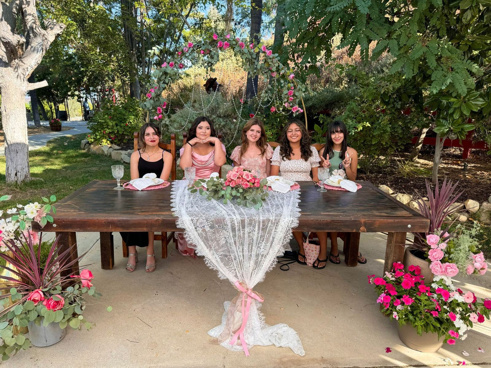
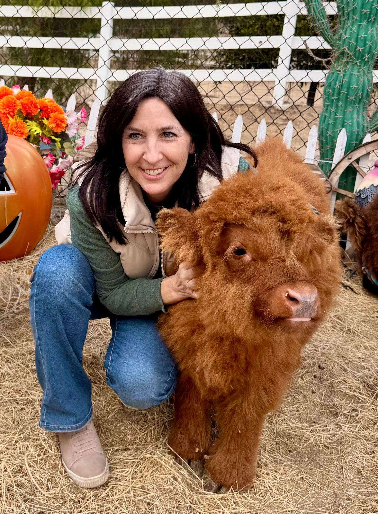
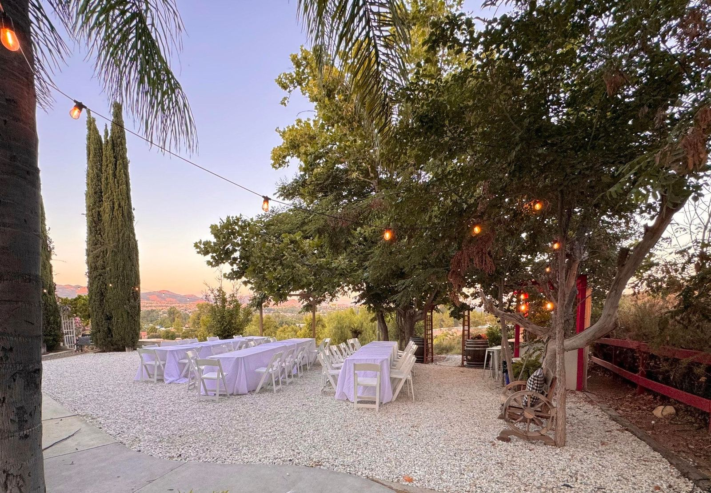
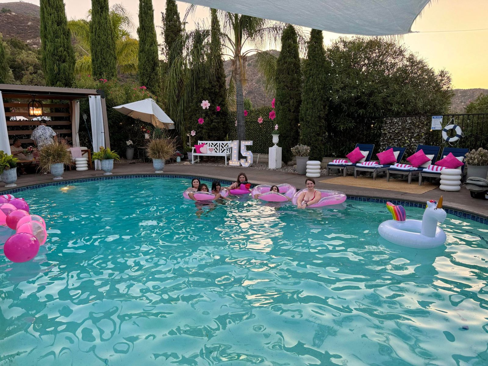
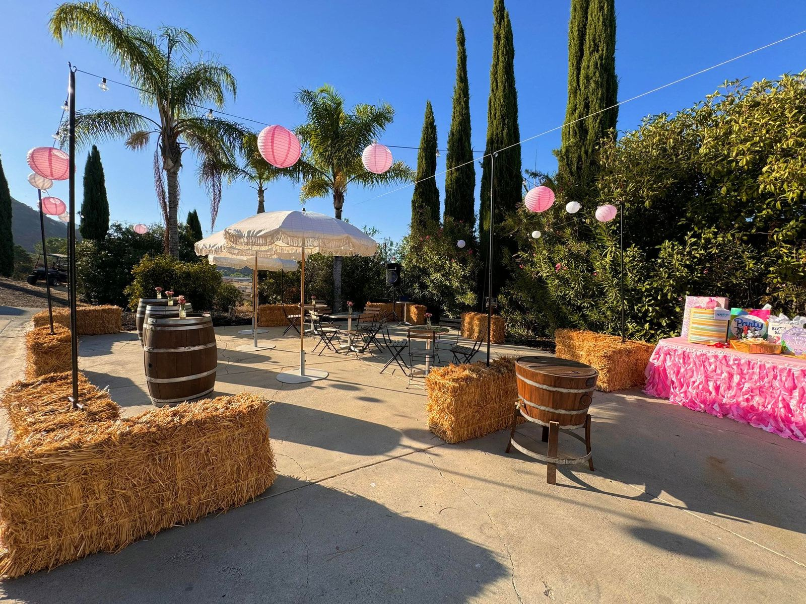
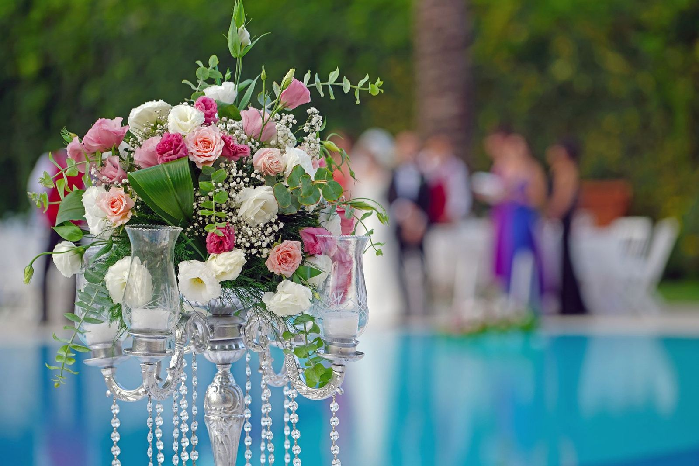
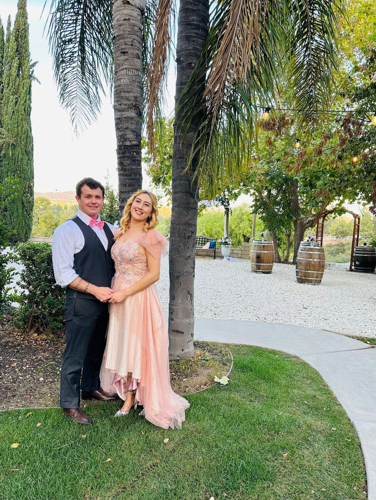
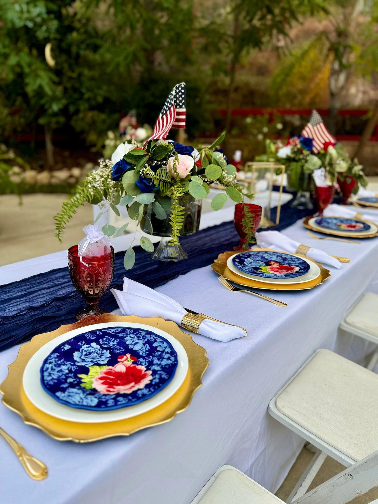

---

<a class="button" href="/photos">Photos</a>
<a class="button" href="/mini-moo-express">Mini Moo Express</a>
<a class="button" href="/weddings">Weddings</a>

# OUTDOOR FARM SPACES & EXPERIENCES

Perched on a hilltop in the Santa Rosa Plateau foothills beside Bear Creek Golf Course and La Cresta, Howe Ranch combines panoramic city and mountain views with Old World-inspired landscapes for a serene escape. Since 2021, this unique space has welcomed celebrities and community members alike. Guests can unplug and reconnect in tranquil settings—from the pool oasis to scenic gathering areas—while enjoying our beloved micro/mini-Highland cows and trained farm animals. It’s a one-of-a-kind experience for unforgettable moments on a working farm.

Please note that we are in the process of relocating to our new farm out of state this year, so we are operating on a short planning window while our farm is for sale.

PRIVATE MINI MOO CELEBRATION PACKAGES:

By making a booking inquiry you confirm that you have reviewed and acknowledged our [Event Space Reservation Checklist](/booking-checklist), the [FAQs](/_files/ugd/fca21d_7c56433a6d0c4c89b8d61edb44bb97a0.pdf), [Farm Policies](/_files/ugd/fca21d_92e2fa4731e648b2a65c17c20956f16c.pdf), [photos](/photos) and the [Howe Ranch Visitor Waiver.](/_files/ugd/fca21d_25540bdb448e4387a9ed9bace59f96b9.pdf)

We currently offer the following options for animal centered gatherings at Howe Ranch:

[Seasonal Mini Moo Express (min. 15 Guests](/mini-moo-express))

[The Enchanted Moments Package](/_files/ugd/fca21d_084b767e2a214a25932cffe6930a7016.pdf) (Groups up to 60)

How can I tour the farm to plan a gathering?

Prior to requesting a Site Tour you must acknowledge and accept our venue pricing and venue guidelines (links above), as neither are negotiable.

1\. [Request a free guided virtual site tour](mailto:howeranchservices@gmail.com?subject=Video%20Tour%20Inquiry)

2\. Request [an in-person farm tour ($250 for up to 2):](mailto:howeranchservices@gmail.com?subject=Venue%20Tour%20Inquiry) (fully credited toward event booking) and sign the waiver. This is not a Private Mini Moo Experience. You will tour the areas of the animals and see them, but the focus of this tour is to visit the gathering spaces and go over the flow of the gathering.

Liability Disclaimer: We cannot offer in person site tours without registration & waiver. No exceptions. 

Details about themed spaces below.

---

---

<a class="button" href="/mini-moo-express">Mini Moo Express</a>
<a class="button" href="https://photos.app.goo.gl/9VcGLyofqEq4aqBWA">Photos</a>

---

### VALLEY VIEW TERRASSE

<a class="button" href="/general-clean-1">Photos</a>

The Valley View Terrasse is a large patio area lined by Mediterranean hardscape and foliage that overlooks the barn, pasture, livestock and the distant Temecula valley and mountain ranges. For special events we can provide and set up professional backdrops in the area of the flag post. This space is ideal for private tea or dinner parties, sunset soirées, small ceremonies, and golden hour receptions.

---

### HIGHLAND VISTA

<a class="button" href="/festival-and-ceromony">Photos</a>

Not offered while the farm is for sale. Perfect for ceremonies and celebrations, as well as themed gatherings, this space has hosted our Harvest and Holiday festivals, wedding ceremonies, baby showers, birthday parties, and our farm animal encounter for disaster responders. Enjoy stunning views from this area, which also features a multi-purpose farm stand/booth/bar, a grapevine arch and a 7 ft. barnwood arch. Guests arrive via a meandering path walking through a carefully curated garden with a large fountain, adorned with an abundance of blooming flowers, lush foliage, and mature trees, A videographer’s delight, this space is overlooking the corrals and mountain ranges from Temecula to San Diego.

---

### SUNSET SANCTUARY

<a class="button" href="/">Photos</a>

The resort-style pool area is furnished with two large cabanas, lounge and dining spaces, toys, custom lighting, and can be customized to your desires. The adjacent space called "The Plaza," which borders the Santa Ana mountains, has been used as banquet space under the stars with a dance area, catering galore, ADA parking, and captivating photo sessions with the magnificent backdrop of untouched splendor of the surrounding wilderness.

---

### THE PLAZA: DINE & DANCE AREA

<a class="button" href="/dance-and-dining-areas">Photos</a>

The property features two large multi-purpose areas on concrete ground, adjacent to the popular event lookout and animal encounter venues. Here is where you can set up banquet tables, vendors, and a dance area:

The Plaza 

This venue is surrounded by wilderness to the West, and lush mature landscaping to the South and East. It features extended space for inflatable rentals, foo truck and full catering kitchen set up, served by water and electric. Can also be set up to provide accessible parking. 

The dance floor set up is an add on that includes bales of straw, café lights and sound.

Barn Courtyard

This casual multi-purpose space sits near onsite parking, the animal barn with a restroom, a service area pavilion, with natural shade provided by a mature tree. Can also be set up to provide accessible parking. Note: No amplified music in this space, as it is by the animals.

---

### SAND COURT at the Barn Courtyard

<a class="button" href="/sand-pit-photos">Photos</a>

Surrounded by the gentle sounds of our happy animals, the animal barn area exudes a cozy, down-to-earth vibe with a large banquet area: An 80 ft. X 45 ft sand pit that features tables and benches for a party of 80, games and toys, and is decorated seasonally with photo backdrops featuring bales of hay and farm props and decor. 

The adjacent concrete pad offers a fun, multi-purpose area for the rustic feel.

---

---

## Farm Wedding?

[2025 Wedding Packages](/weddings)

BYO Wedding and Add Ons can be explored on [Howe Ranch Weddings on Peerspace](https://www.peerspace.com/pages/listings/647591b224653c000e5d878f?utm_source=copy_link&utm_campaign=listing_sharing).

---

