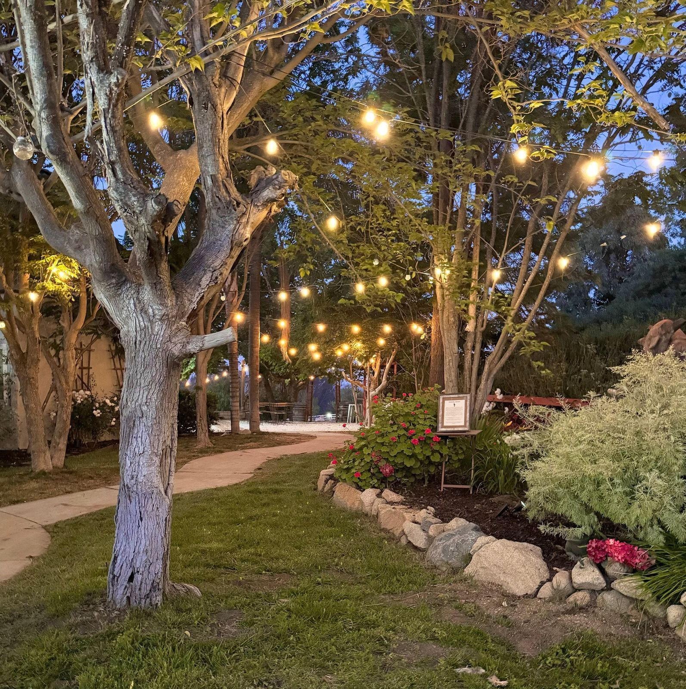

# Events FAQs

All the Answers to Your Questions

---

### How can I book an event or visit?

We're thrilled you're considering Howe Ranch for your gathering! To ensure a smooth and efficient planning process, we've established guidelines to maintain professionalism and respect throughout our interactions. Please review the following expectations for communication and inquiry handling:

Valuing Time: We appreciate timely responses, especially after we have provided detailed information or answered queries. This helps us manage our schedules effectively, given our daily commitments to maintaining our farm and caring for our animals. 

Professional Communication: We expect all interactions to be conducted with professionalism. This includes clear, respectful communication and adherence to agreed-upon terms. 

Accurate Information:

When making inquiries or bookings, please ensure you provide complete and accurate details as required by our booking standards and partner platforms. This helps us facilitate a smooth and seamless process. If there’s a possibility that your event guest count might increase, you must disclose this during the reservation process. Please note that events cannot be scaled up within three months of the event date. Scaling up prior to that period will incur additional costs across all areas of service.

Example: Do not submit a guest count of 90 in the hopes of getting better pricing, if you’re inviting 125 guests. This is considered dishonest practices and will not be tolerated. We can only work with Clients who are partners to us and respect the venue and community guidelines set forth.

Disclaimer: We reserve the right to discontinue communication or adjust service offerings if these standards are not met. This policy ensures that we can continue providing the best possible experience to all our guests while respecting the effort and resources that go into preparing our venue. We also reserve the right to terminate any event agreement if the Client fails to adhere to terms or if the event is deemed to pose a risk to the Venues/attendees.

Booking Options:

1\. Reserve your private gathering through [Swimply ](https://swimply.com/pooldetails/41996)if you plan to swim or book a gathering only in the pool area.

2\. When you have your event details in order you can make a booking request directly to Howe Ranch. Here is the pricing calculator: [Peerspace](https://www.peerspace.com/pages/listings/647423c524653c000e5d50e2?utm_source=copy_link&utm_campaign=listing_sharing). You can also utilize the [Howe Ranch Fee Schedule](/_files/ugd/fca21d_0b89a47827154ad1aadcd3fc5eed0128.pdf) planning tool. Note: Prices are not negotiable. Submit all of the following:

a. Date, start and end time of the event including set up and break down

b. Maximum number of guests.

c. Services planned and needed

Alternatively, you can make a booking inquiry via text message inquiry to 951-249-3826. Text messages will be replied to by the end of the day.

3\. For a simple private event booking, you can go through [Peerspace,](https://peerspace.app.link/9m7WzOZNyCb)[ which offers you day of event insurance, as well.](https://peerspace.app.link/9m7WzOZNyCb)

4\. For a wedding ceremony or reception, review our [Wedding Celebrations page](/weddings) and utilize the DYI tool on our Wedding listing on [Peerspace](https://www.peerspace.com/pages/listings/647591b224653c000e5d878f?utm_source=copy_link&utm_campaign=listing_sharing). Note, a wedding reception is a "wedding event," so is an Elopement Party and so is a Micro Wedding. They are not categorized as "special event" and require wedding event resources and services from us.

5\. To experience a [Farm Stay](/stay-a-while) reach out to us directly. We do not offer this experience to the general public.

6\. To reserve a camping spot go to [HipCamp](https://www.hipcamp.com/en-US/land/california-howe-ranch-petting-zoo-camp-zwjh2znz/sites/923601?shareid=2fqcsq4zqnv). Single family site booking only. No groups, no gatherings. Offered on select dates of the year.

<a class="button" href="mailto:spencerahowe99@gmail.com?subject=Howe%20Ranch%20Event%20Booking%20Inquiry">Booking Inquiry</a>

---

### What are the Rules we should be aware of?

1. Speed Limit Compliance: The private road leading to the farm venue serves as a trail for farm animals and is subject to constant monitoring and regulatory scrutiny. All guests and service providers must adhere to a 15 mph speed limit while on this road. Failure to comply with this speed limit is a serious violation that could lead to the immediate shutdown of the event.
1. Parking On Site Only: Guests must park in the designated parking lots on the property, not on the private street or a neighbor's estate. If guests violate the parking rule, the gathering will be cancelled immediately. We can only offer gatherings if guests respect our neighbors.
1. Guests must not feed any of our livestock, unless an animal encounter is part of your booking, and the activity is supervised. You will receive the feed appropriate for the animals. Feeding the donkeys especially can lead to choking death. Feeding the goats chicken feed will kill them.
1. You must book time for set up and break down if you have any type of food sevice/decor/vendor etc planned. No member of your party is allowed on the premises before or after your booked time; No exceptions. The property gate is closed before and after your event time. We offer a set up or break down add on for events with 50+ guests. Max 60 minutes set up and max 60 minutes break down (through Swimply max 30 min.).
1. Every visitor acknowledges our [waiver.](/_files/ugd/fca21d_c07e0db3517f4948b59b9f415c59f51e.pdf) It is your responsibility to watch your children throughout the entire time of your booking.
1. Restoration: Leave the area the way you found it (collect toys, your decorations/decor trash, balloons etc.). Ensure that everything (furniture, decor, planters, etc) is placed the way it was. If you do not stage the furniture the way it was at arrival, or if you leave any waste other than food/drink trash (for example if you leave on the property decorations/balloons/etc.) you agree to pay a $150+ restoration fee.
1. Damage/Loss: If anything breaks during your stay, report it to the host right away and make arrangements for replacement. If your guests take something of ours, you are responsible for immediate replacement.
1. Note: Towels and swimsuits are not included in stays, but available as a an add on should you have forgotten a towel/bathing suit.
1. Sound Levels: The atmosphere at our venue is intended to be lively yet suitable for a farm setting. To ensure the comfort of all guests and the wellbeing of our animal residents, moderate sound levels must be maintained throughout the event. Loud or high-energy music that could disturb our animals or the surrounding environment is strictly prohibited. No entertaining/amplified sound past 9:00 PM. Sound cannot be heard outside of the contracted venue/area, and not at all past 9:00 p.m. The sound limit is 85dB and is monitored electronically and by security. DJ Service must be approved, and requires retention of security services through Howe Ranch.\*
1. No heavy drinking and zero drug policy enforced. If you plan to host a drinking party and or/420/rave-like party, our farm is not a suitable place for you. Alcohol service must be approved by venue, with only a few limited events per year permitted to include alcohol service. Licensed bartending service and security service must be contracted through Howe Ranch. [Alcohol and Security Service FAQ Sheet.](/_files/ugd/fca21d_fb838f8775dd4e79b5fd5d2662a29c58.pdf) \*
1. Waste Management: Ensure that consumable trash is in the trash receptacles or bagged and closed. Food and waste must not be left out, anywhere. Guests are responsible to remove all other waste related to their gathering, such as decorations, balloons, etc.
1. Safety & Event Terms: We reserve the right to terminate an event agreement and cancel the event if the client fails to adhere to event contract terms or if the event is deemed to pose a risk to the Venue/attendees.
1. Private Event Clause: Howe Ranch is committed to ensuring a safe and enjoyable environment, thus only private events with personally invited friends and family by the host are permitted. Public events, influencer parties, and events with guests unknown to the host are strictly prohibited. Hosts must submit a guest list for approval prior to the event, detailing the relationship between the host and each attendee. Failure to adhere to these conditions will result in immediate event cancellation and will lead to forfeiture of any deposits or fees paid, in accordance with our standard cancellation policy.
1. Power and Electrical Guidelines for Vendors: If your event includes vendors with high-powered commercial equipment, such as concession stands with fryers or other cooking equipment, you must arrange for them to bring their own generators or power banks. Using our 15-20 AMP outlets for high-powered devices can create fire hazards and cause power failures, which could disrupt your event.
1. Lost and Found Policy: At Howe Ranch, we cannot assume responsibility for personal items left behind. 

Personal Responsibility: Guests are responsible for their belongings during their visit. 

End of Event: Ensure you have all your items before leaving. Left-behind items will not be stored or mailed. 

No Lost and Found: We do not maintain a lost and found service due to limited capacity.

Final Collection: Items left behind will be discarded if not collected by the end of the event. Special pick-up times or mailing requests cannot be accommodated.

\* [FEE SCHEDULE](/_files/ugd/fca21d_fb838f8775dd4e79b5fd5d2662a29c58.pdf)

Security Services: Minimum of 4 hours - $90/hour

Bartending Services: Starting at $75/hour for up to two cocktails plus wine or beer or champagne (3 total)

---

### Where do we park for an event?

There are 15 - 17 parking spots in the upper multi-purpose area on the top of the property. For overflow parking go 1/3 of the private driveway up, turn left towards the stables. There is another paved and unpaved area that accommodates 8 cars. 

For gatherings with more than 30 pool vehicles we will coordinate use of the large pasture for the parking plan.

---

### How do I pay?

Farm tours/farm animal encounters and farm days can be booked through our site:

[thehoweranchpayment.com](https://thehoweranchregistration.com/)

For your convenience, we also accept payments as follows: 

VenMo | PayPal | Zelle
