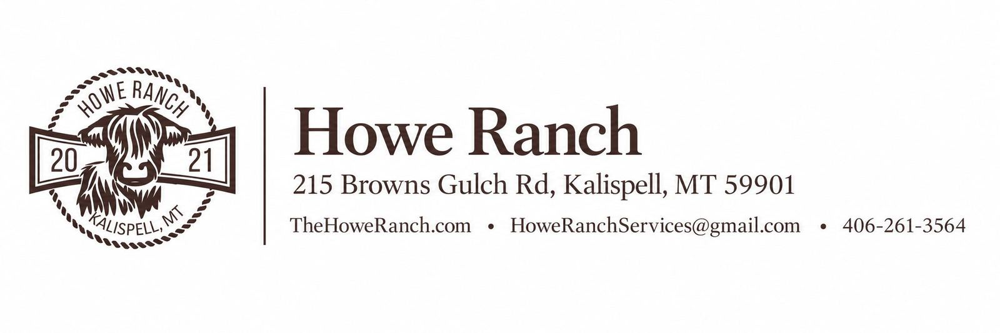
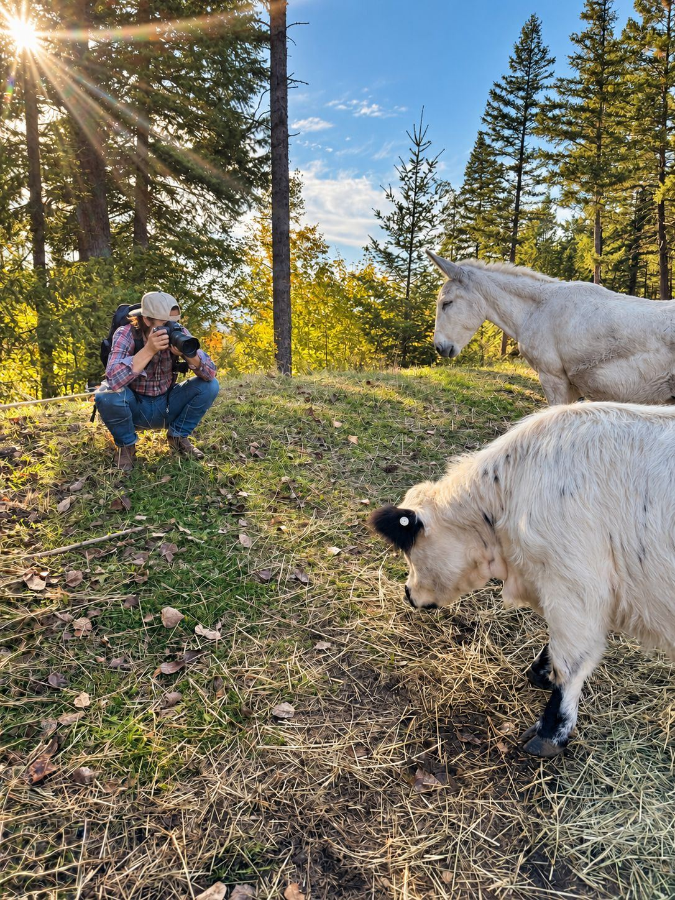
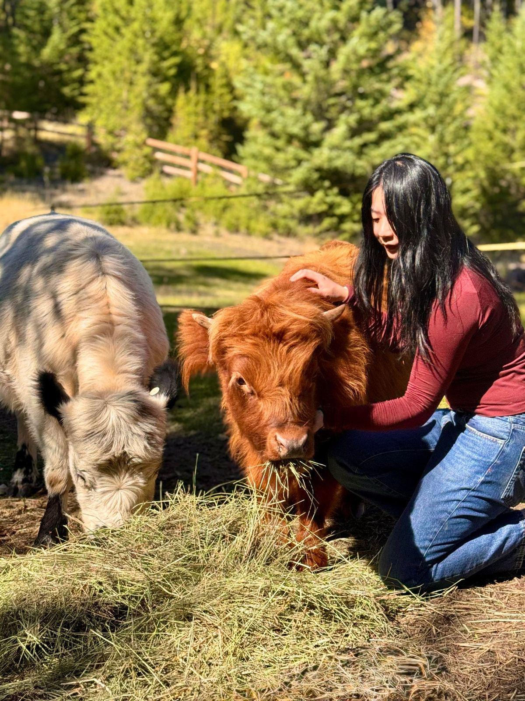
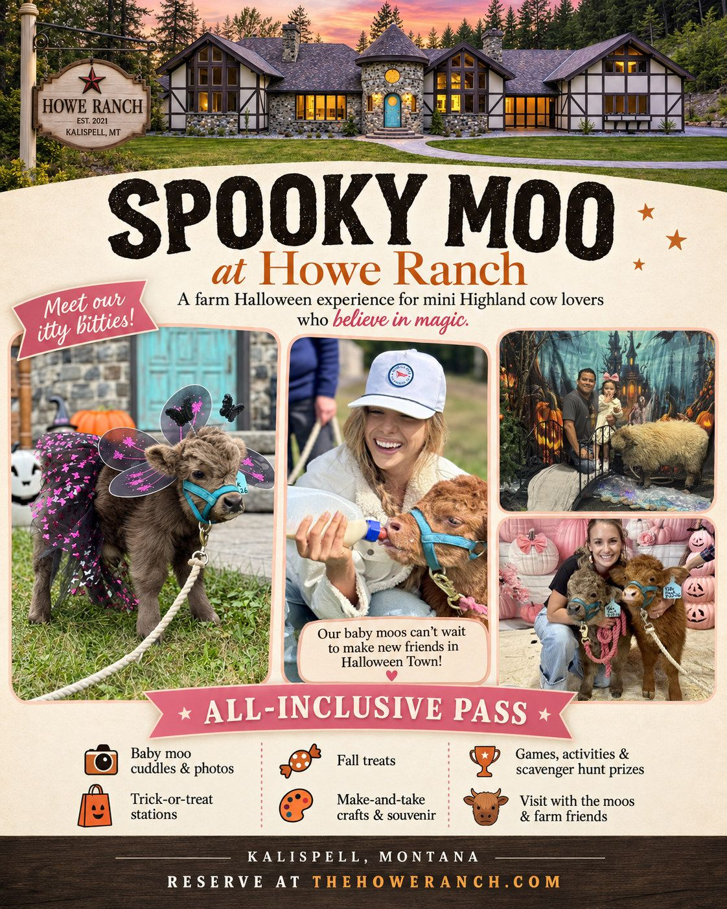
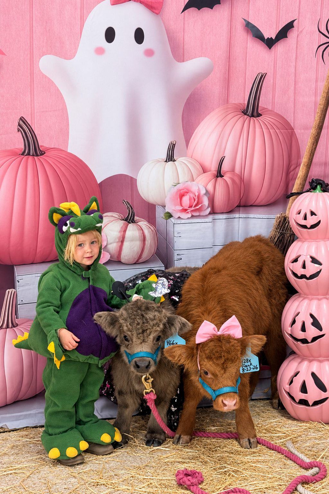

# MEDIA & PRESS INQUIRIES

---

Howe Ranch welcomes inquiries from journalists, editors, television and radio producers, photographers, travel writers and other members of the working media.

Media inquiries may be submitted at any time for interviews, editorial coverage, photography, filming, feature stories and other press opportunities.

Throughout the year, Howe Ranch also designates select Media Days during major seasonal experiences, offering approved media representatives an opportunity to visit the ranch, gather photography and video, interview members of the Howe Ranch team and experience the current seasonal offering firsthand.

Advance coordination is required for all media visits, as Howe Ranch is a private working farm and visits are available by reservation only.

Current 2026 Media Days

- Spooky Moo: October 18
- Mini Moo Magic Holiday Photo Afternoon: November 8
- Winter Wonderland: December 6

For media inquiries, interview requests or Media Day credentials, please contact: 

[howeranchservices@gmail.com](mailto:howeranchservices@gmail.com)

---

## Content Creator Opportunities

Howe Ranch does not offer paid content creator or influencer collaborations. Qualifying content creators may instead be considered for one complimentary pass to experience one of our seasonal events in exchange for approved social media coverage.

Hosted creator access is limited, subject to availability and must be approved in advance.

Creators requesting complimentary admission should generally have 10,000 or more followers on at least one primary public social platform and must include links to their active channels. Please also include a brief description of the content you propose to create and which Howe Ranch media day you are interested in attending.

Priority consideration is given to creators whose audiences align closely with Howe Ranch, including those focused on Montana, Idaho, Washington, Alberta and surrounding regional travel markets, as well as family travel, tourism, holiday experiences, animals, photography and regional lifestyle content.

Select creators with smaller but highly engaged or particularly relevant regional audiences may be considered at Howe Ranch's discretion.

Complimentary creator admission is the collaboration offered; Howe Ranch does not provide creator fees, appearance fees, travel reimbursement, lodging or other monetary compensation.

---

## Oct. 2026 Media Advisory

HOWE RANCH UNVEILS ITS SIGNATURE SEASONAL EXPERIENCES IN KALISPELL, MONTANA

Regional media and qualifying content creators invited to experience Spooky Moo, Mini Moo Magic and the 17th Annual Winter Wonderland during special Media Days

KALISPELL, Mont. — October 2026 — Howe Ranch is bringing its signature style of immersive, animal-centered seasonal experiences to its new home in Kalispell, Montana, beginning this fall with Spooky Moo, followed by Mini Moo Magic Holiday Photo Afternoons and the ranch’s 17th Annual Winter Wonderland.

Set in the foothills of Glacier National Park, the private family farm has created again this year an evolving calendar of storybook experiences built around its beloved miniature Highland cows, other farm animals, elaborate seasonal settings, hands-on activities, treats, crafts and highly photographable moments for families, couples and animal lovers.

Rather than operating as a traditional walk-through attraction or public petting zoo, Howe Ranch creates fully hosted experiences that change throughout the year — giving guests time to interact with the animals, explore the ranch and become part of each season’s story.

This fall and holiday season begins with playful Halloween magic in October, moves into intimate holiday photo experiences in November, and culminates in Howe Ranch’s longstanding Winter Wonderland tradition through the Christmas season.

And the calendar does not end with Christmas. Following Winter Wonderland, the ranch will transition directly into its annual Season of Love, transforming once again for approximately six weeks of romantic, whimsical winter photo opportunities and experiences surrounding Valentine’s season.

OCTOBER: SPOOKY MOO

Throughout October, Howe Ranch becomes Halloween Town for its annual Spooky Moo experience.

Guests can mingle with the farm’s tiny Highland cows and their farm friends, explore whimsical Halloween spaces, trick-or-treat, complete the Spooky Moo Scavenger Hunt, create a seasonal keepsake, enjoy treats and drinks, and capture unlimited photos throughout the ranch.

The experience combines friendly ghosts, pumpkins, potions, witches and playful Halloween surprises with hands-on animal encounters designed for children and adults alike.

Spooky Moo continues on select October dates, including October 11, October 18, October 25 and October 31.

NOVEMBER: MINI MOO MAGIC HOLIDAY PHOTO AFTERNOONS

In November, the ranch begins its transition into the holidays with Mini Moo Magic Holiday Photo Afternoons.

These intimate seasonal afternoons combine the full Howe Ranch animal experience with professionally captured holiday photo opportunities featuring the ranch’s miniature Highland cows and other animals.

Families and couples can spend time with the baby moos, goats, lambs and other ranch residents while enjoying seasonal activities, refreshments and crafts, with both posed and candid holiday images included as part of the experience.

Rather than a traditional stand-and-pose photography session, Mini Moo Magic is designed as an experience first — allowing genuine interaction with the animals while photographers capture the moments naturally.

LATE NOVEMBER - JANUARY: THE 17TH ANNUAL WINTER WONDERLAND

As the Christmas season arrives, Howe Ranch transforms for the 17th year of the family’s signature Winter Wonderland tradition.

The ranch becomes a cozy, storybook Christmas world filled with tiny Highland cows, fluffy farm animals, twinkling holiday spaces, warm seasonal treats, hot craft drinks, holiday arts and crafts, a Winter Wonderland scavenger hunt, visits with Mrs. Claus and special appearances by Santa.

Guests are encouraged to slow down, explore, interact with the animals, take as many photographs as they wish and spend approximately two hours immersed in the experience.

Set among evergreens, mountain views and the ranch’s glacier-fed creek, the Montana setting marks a new chapter for a Howe Ranch Christmas tradition that began in 2010.

All activities, animal encounters, crafts, seasonal treats and drinks are included with admission.

MEDIA PREVIEW & COVERAGE DAYS

Howe Ranch is extending invitations to members of the press, broadcast media, regional publications, travel and lifestyle media, and qualifying digital content creators for designated Media Days during the 2026 season. Due to liability reasons, our programming is capped and advance registration and signed waivers are required.

Spooky Moo Media Days: 

Sunday, October 18

Mini Moo Magic Media Day: 

Sunday, November 8

Winter Wonderland Media Day: 

Sunday, November 29

REGISTRATION REQUIREMENT

Media representatives may request access for editorial coverage, photography, broadcast segments, interviews and on-location reporting.

Advance RSVP and confirmation are required. Howe Ranch is a private farm and is open to guests by advance reservation rather than general walk-in admission.

Visitors, including members of the press, complete a visitor waiver because experiences onsite include direct interaction with cattle and other animals.

---

## About Howe Ranch

Howe Ranch is a private, family-owned boutique animal farm destination set in a storybook alpine setting in the foothills east of Kalispell, Montana, with sweeping valley views, towering evergreens and a glacier-fed creek winding through the property. 

Centered around miniature Highland cows and beloved barnyard animals, Howe Ranch offers intimate, advance-reservation experiences, farm stays, seasonal events, weddings and celebrations… all thoughtfully designed around connection, old-world hospitality and creating the kind of joyful moments families carry with them for a lifetime. 

The Howe Ranch experience has welcomed guests for more than five years, building on more than 25 years of the family creating magical guest spaces, seasonal traditions and warm hospitality for thousands of guests.

MEDIA / CREATOR RSVP & INTERVIEW REQUESTS

Howe Ranch 

Kalispell, Montana 

Email: [howeranchservices@gmail.com](mailto:howeranchservices@gmail.com) 

Website: thehoweranch.com

<a class="button" href="/about-5">Meet the Family</a>

---

## Media Resources

Website 

Event information, reservations and additional details: 

[https://www.thehoweranch.com](/)

Media Library — Photos & Video 

Photos, video clips and approved media assets are available here: 

[Halloween Media Album Link](https://photos.app.goo.gl/iBt2AEpgaji522yX7)

Additional Media:

[Photos | Howe Ranch](/photos)

Reviews & Guest Feedback 

Read verified guest reviews from Howe Ranch’s previous location:

New Google Profile since opening in MT location in September:

[READ REVIEWS →](https://maps.app.goo.gl/UBuX9FeqdVraHEur9) 

Old Google Profile | 262 Five-Star Reviews · 5.0 Average: 

[READ REVIEWS →](https://share.google/XkWWscDj8Nto7uBHC)

Social Media 

Follow Howe Ranch for current ranch life, animals, seasonal transformations and event updates:

Instagram: [@howe_ranch](https://www.instagram.com/howe_ranch/) 

Facebook: [The Howe Ranch](https://www.facebook.com/p/The-Howe-Ranch-61556938111897/)

For additional photography, video, interviews, media visits or other press materials, please contact: 

[howeranchservices@gmail.com](mailto:howeranchservices@gmail.com)

