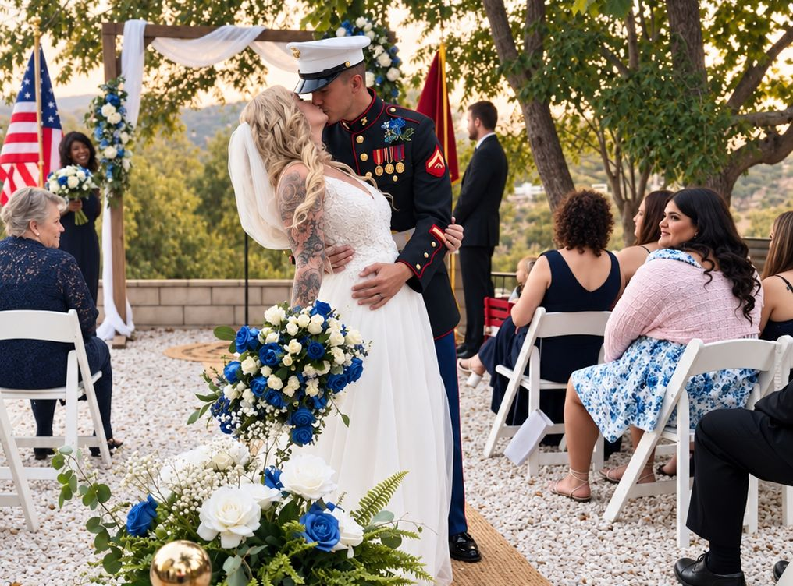

# The Howe Ranch Intimate Wedding

### ◆ For our Signature Wedding Experience Visit [Here ](/weddings)- Below is for our Micro Wedding Experience only ◆

### A Little More Intimate. Every Bit as Magical.

$6,500 | Up to 50 People | Select Thursdays, Fridays & Sundays

Some of the most beautiful celebrations are the ones shared with just your closest people.

---

Our Intimate Wedding Experience brings together everything that makes Howe Ranch so special — our enchanting private Montana estate, fairytale settings, thoughtfully styled spaces, beloved miniature Highland cows and barn friends, and the warm, personal hospitality we're known for.

Designed for couples who want a beautiful wedding without the complexity of an extended wedding weekend, this experience includes a complete, privately hosted ceremony and reception, with the details thoughtfully brought together by our team.

### Your Intimate Wedding Includes

- Six hours of private wedding access, from 3:00 to 9:00 p.m. or 4:00 p.m. to 10:00 p.m. (depending on availability).
- Up to 50 attendees, including the couple and outside vendors.
- Bridal & Groom's Preparation Quarters: Use of our private bridal and groom's quarters for final wedding-day preparations, finishing touches, and those special moments leading up to the ceremony, during your reserved access window.
- Your choice of available ceremony settings.
- Optional reception in our Grand Hall (four-season Event Barn).
- Use of designated Fairytale Village and Sugar Plum Lounge spaces.
- Tables, chairs, standard linens and available event furnishings.
- A beautifully coordinated ceremony arch and table centerpieces featuring our silk floral collection and fresh greenery accents.
- Your choice of a hosted taco bar or curated grazing experience.
- A refreshing house beverage bar with up to three non-alcoholic selections.
- Scheduled encounters and photo opportunities with our miniature Highland cows and beloved barn friends.
- Access to designated scenic photography settings and existing styled backdrops.
- Dedicated Wedding-Day Coordination: Guidance throughout your celebration, including timeline management, vendor coordination, and a seamless transition from ceremony to reception.
- Two Personalized Pre-Wedding Consultations: Time with our team to discuss your vision, coordinate arrangements, and finalize your celebration details.
- Howe Ranch hospitality, guest-experience and animal-care staff.
- Standard setup, service, breakdown and cleanup.

### A Beautifully Simple Celebration

Sample timeline:

Arrive at 3:00 p.m. to prepare for your celebration, with your guests welcomed at 4:00 p.m. Exchange vows, enjoy your first moments as newlyweds, gather over delicious food and refreshing drinks, and spend the evening making memories with those who matter most.

Our intimate celebrations conclude at 9:00 p.m. (or 10 p.m. if you arrive at the venue at 4:00 p.m.), allowing you to enjoy a complete wedding experience without the commitment of a full wedding weekend.

### Make It Your Own

For couples who would like to add a few personal touches, select enhancements may be arranged separately, including specialty beverages, licensed bar service, personalized décor, custom floral installations and overnight accommodations, subject to availability.

Our Intimate Wedding Experience is offered as a thoughtfully curated, shorter celebration with a defined selection of inclusions. Couples seeking extended estate access, banquet dining, overnight accommodations and greater customization are invited to explore our [Signature Wedding Experience](https://thehoweranchregistration.com/weddings).

Intimate Wedding Experience:

$6,500 flat rate for up to 50 attendees.

Available on select Thursdays, Fridays and Sundays (not on Saturdays).

[Inquire About Your Intimate Wedding Experience](mailto:howeranchservices@gmail.com?subject=Intimate%20Wedding%20Date%20Inquiry)
