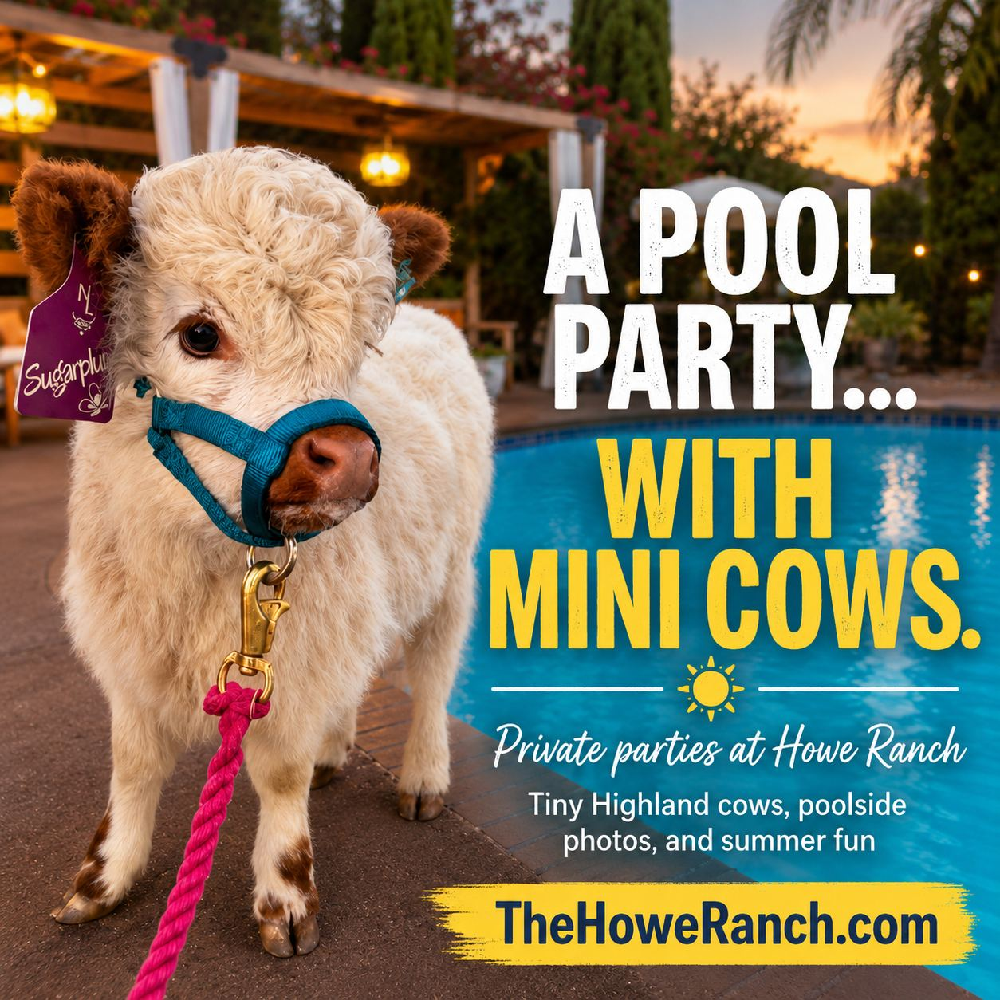

# Mini Moo Express

Perfect for School Groups, Company Outings, Organizations and Family/Friend Groups Special Occasions with 15+ Guests

Prior to requesting a booking, guests review [photos](/photos) and [guest reviews](https://www.google.com/search?sca_esv=e056365929846744&sxsrf=ANbL-n6vAnvA5ZZ09F6822rzvB2JDM4LgA:1768472070987&kgmid=/g/11rd00snqm&q=Howe+Ranch&shndl=30&source=sh/x/loc/uni/m1/1&kgs=b10bb89e4349e5c5&shem=shrtsdl&utm_source=shrtsdl,sh/x/loc/uni/m1/1), and acknowledge the [FAQs](/_files/ugd/fca21d_ffa1f162f741457685083f593d3f9a1c.pdf) and the [Farm Venue Policies](/_files/ugd/fca21d_b3646e5a5ec9407a829c5cf5f740f7c5.pdf)

AVAILABILITY: 

Please submit your preferred date and time, along with an alternative option. Scheduling is based on availability around our regular farm activities and existing bookings.

Due to high seasonal demand and the volume of inquiries we receive, dates and times cannot be guaranteed until the booking is completed and payment is processed. [Request a Date. ](https://thehoweranchregistration.com/mini-moo-express)[Your request will be answered within 12 hours during the week/24 hours on the weekend. ](https://thehoweranchregistration.com/mini-moo-express)

Looking for a charming, and budget-friendly way to experience the farm as a private group? Mini Moo Express is a delightful private experience designed for corporate outings, youth groups, organizations, and social/family groups who want a meaningful farm visit without the time commitment of a full private event.

Experience details, pricing tiers, and guest count policies apply. Please see Guest Count & Minimum Policy below.\*

Experience Length:

This all-inclusive experience runs 2 hours with the first hour being the signature, facilitated animal experience in different areas of the magical estate.

This Visit Includes:

- Farm Animal Experience: Get up close and personal with our micro mini-Highland calves and other friendly farm animals (goats, donkeys, mini cows, lambs), perfect for kids and adults alike to enjoy hands-on interactions and learn about life on the farm in a magical setting.
- Photo Moments: Capture sweet memories throughout the farm with photo backdrops, rustic and fairytale decor, and stunning settings featuring our adorable animals.
- Exclusive Pool Sanctuary Access: Enjoy private use of our pool sanctuary area, featuring large, shaded cabanas, lounge seating, and a beautiful poolside setting for relaxing, gathering, and taking photos during your visit.
- Optional Pool Swim Optional pool swim is included with Mini Moo Express where appropriate for the season and visit type. Guests who would like to swim should bring their swimsuit and towel. The pool is seasonal temperature and is not heated. The hot tub may be heated optionally when available and arranged in advance because it is on propane. Forgot your towels? See add-ons for towel service..
- Seasonal Treats: Enjoy delicious, iced German coffee and lemonade on the house.
- Accommodations: Unlimited on-site parking, two restrooms (1 has accessible sink and grab bars), air-conditioned club room with fridge space for cake

Ideal for groups looking to enjoy a festive farm experience without a half-day commitment, the Mini Moo Express is the perfect way to celebrate the season!

- Due to facility regulations, guests cannot bring outside food, except for cake. No alcohol permitted/service offered. Guests bring their own water. 
- Booking has to be completed at least 3 days in advance

[Explore Food & Beverage Add-Ons](/_files/ugd/fca21d_798b86976eca4cdab07ff465e13b77f2.pdf)

Booking fee includes Venue Fee, Activities, and Animal Experience (not Add-Ons):

$50/Guest for groups 15- 29 

$45/Guest for groups 30+ 

Explore popular add-ons [here](/_files/ugd/fca21d_9b7e06ae389649d688276fa7872509b4.pdf).

Prior to requesting a booking, guests review [photos](/photos) and [guest reviews](https://www.google.com/search?sca_esv=e056365929846744&sxsrf=ANbL-n6vAnvA5ZZ09F6822rzvB2JDM4LgA:1768472070987&kgmid=/g/11rd00snqm&q=Howe+Ranch&shndl=30&source=sh/x/loc/uni/m1/1&kgs=b10bb89e4349e5c5&shem=shrtsdl&utm_source=shrtsdl,sh/x/loc/uni/m1/1), and acknowledge the [FAQs](/_files/ugd/fca21d_ffa1f162f741457685083f593d3f9a1c.pdf),the [Farm Venue Policies](/_files/ugd/fca21d_b3646e5a5ec9407a829c5cf5f740f7c5.pdf), and Guest Count Policies below: 

\*Guest Count & Minimum Policy\*

• Mini Moo Express requires a minimum of 15 paid guests to staff and operate this facilitated group experience. 

• Groups of 14 or fewer may participate by reserving and paying for 15, which meets the minimum required for this programming. 

• Children under 12 months are complimentary and do not count toward the guest minimum. 

• All guests ages 1 and up are considered paid guests and count toward the minimum and pricing tiers. 

• Pricing is based on the number of paid guests reserved and cannot be adjusted based on attendance or group size below the minimum.

Resources contracted for your gatherings are planned based on the original booking size and add-ons, which cannot be decreased, but group sizes can possibly be increased and add-ons added until a cut-off date which is determined based on your group size.

This policy ensures appropriate staffing, animal care, preparation, and guest experience quality.

<a class="button" href="/_files/ugd/fca21d_798b86976eca4cdab07ff465e13b77f2.pdf">Add-Ons</a>
<a class="button" href="https://thehoweranchregistration.com/mini-moo-express">Request a Date</a>
<a class="button" href="/_files/ugd/fca21d_ffa1f162f741457685083f593d3f9a1c.pdf">FAQs</a>
<a class="button" href="/photos">Photos</a>
<a class="button" href="/_files/ugd/fca21d_798b86976eca4cdab07ff465e13b77f2.pdf">Add Ons</a>
<a class="button" href="/_files/ugd/fca21d_b3646e5a5ec9407a829c5cf5f740f7c5.pdf">Venue Policies</a>
<a class="button" href="/_files/ugd/fca21d_7a026b7d874d46b4a792235f947af26a.pdf">Arrival Notice</a>
<a class="button" href="https://thehoweranchregistration.com/mini-moo-express">Request a Date</a>

