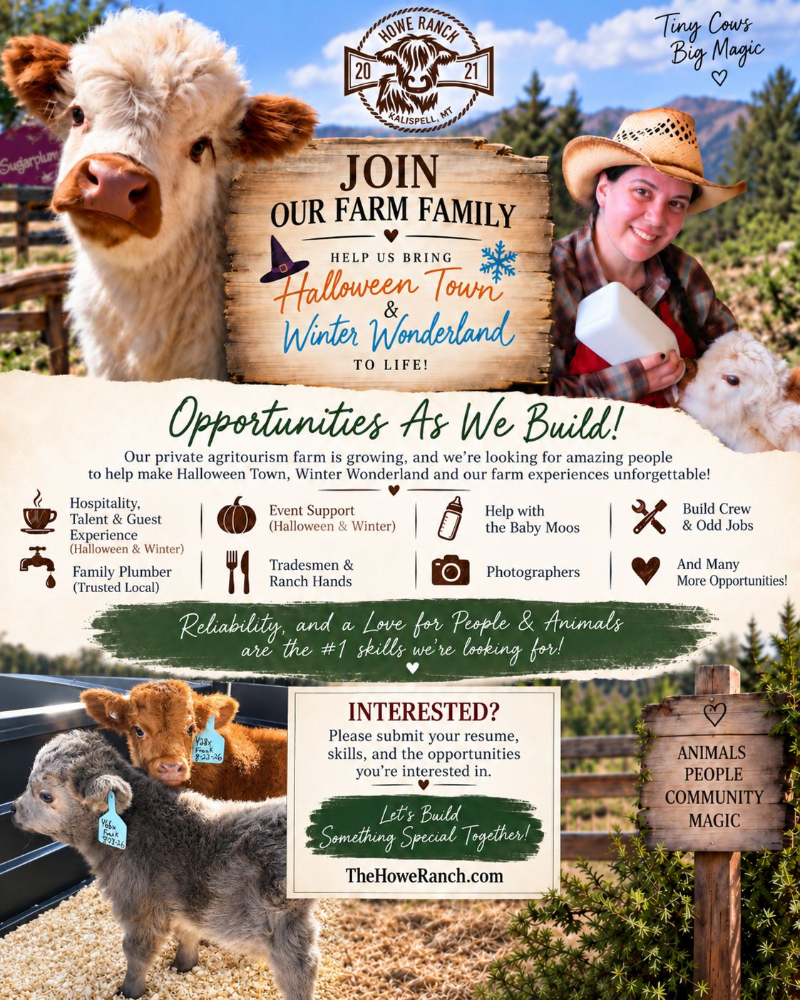

# Opportunities

Howe Ranch is an established private agritourism farm created for people who love tiny Highland cows, sweet cuddly animals, and a little bit of magic. After a long season of planning and transition from our legendary Wildomar location, we are finally bringing Howe Ranch to life in our new fairytale farm village in the foothills east of Kalispell, Montana — with boutique animal experiences, seasonal events, fairytale weddings, and much more.

---

As we build out the ranch and prepare for Halloween Town, Winter Wonderland, and our upcoming farm experiences, we’re looking for dependable local people who would love to be part of what we’re creating.

Opportunities may include:

- Hospitality & Guest Experience (with training and resources)
- Seasonal Talent & Performers\*
- Event Support (parking, security, engagement, check in, orientation, safety brief, prize station, etc.)
- Baby Moo & Animal Care (mucking, feeding, moving)
- Photographers (for our Mini Moo Magic afternoons and holiday events)
- Ranch Hands (handy and hands on, fence work, lifting, etc. included)
- Mini Moo Experience Facilitators (with training and resources)
- Tradesmen & Skilled Labor (farm property development and repairs - hourly or by project)
- Set Builders & Decorators (must be detail oriented and able to follow direction)
- Plumbing & HVAC (looking for family plumber and HVAC person)
- Odd Jobs & Project Help
- …and more as needs arise around the ranch.

\*Seasonal Holiday Experience Talent

We’re looking for fun, dependable, personable talent to help bring the magic of Howe Ranch to life for our Winter Wonderland season, with possible opportunities during Halloween Town as well. This is a hospitality-forward performance role — perfect for outgoing people who enjoy interacting with families, staying in character, creating memorable moments, and being part of a festive atmosphere. Reliability and a warm personality are a must. Costumes are provided by Howe Ranch. Prior acting, mascot, improv, or children's entertainment experience can be preferred, but we are not making professional acting credentials a requirement.

All opportunities involve training and require regular commitment (exception: project based skilled trades activities)

Volunteer opportunities are around hospitality experiences and baby animal care and require continuous commitment due to training investment. All regular engagement opportunities include perks for your family.

We will gladly put you in touch with our staff in Wildomar, so you can get a feel of the Howe Ranch farm family.

Check out our [public guest reviews](https://thehoweranchregistration.com/reviews) to get an idea of what you will be part of. We also encourage you to review our [photo albums](/photos).

The three things that matter most to us are simple: Availability for 3 -- 12 months, Reliability and a genuine Love for People and Animals.

Please apply only if you are available for training now and can commit to 3+ months with Howe Ranch.

These are ongoing opportunities — not one-time volunteer or baby-cow visit opportunities.

Submit your resume, relevant skills, one related reference contact, and the type of opportunity you’re interested in below.

<a class="button" href="mailto:howeranchservices@gmail.com?subject=Howe%20Ranch%20Opportunity%20Inquiry">Apply</a>

