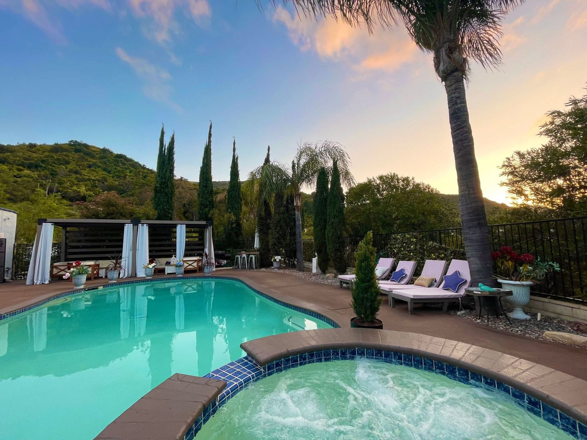

# Pool Venue Rules

Enjoy your stay and come back soon!

---

### Failure to follow the pool rules below will result in a negative review, and/or reporting to Swimply or authorities.

- It is your responsibility to watch your children throughout the entire time of your stay.
- Leave the area the way you found it (collect pool toys, trash, etc.). Ensure that furniture is placed the way it was.
- If anything breaks during your stay, report it to the host right away and make arrangements for replacement.
- Note: Towels and swimsuits are not included in the rental, but available as a courtesy should you have forgotten a towel/bathing suit. Please request use via Swimply messenger. After use dry the towel/bathing suit and put it in the basket provided. To dry a towel, utilize the drying rack for wet towels (not wood furniture). Violating this simple rule will result in an unfavorable review.
- Weekday curfew for amplified music is 9:00 p.m.; Friday and Saturday is 10:00 p.m.
- No heavy drinking and zero drug policy enforced. If you plan to host a drinking party and or/420 party, this is not a suitable venue for you. Light, responsible drinking is welcome.

WiFi: Frontier0960 Password: 8708560608
