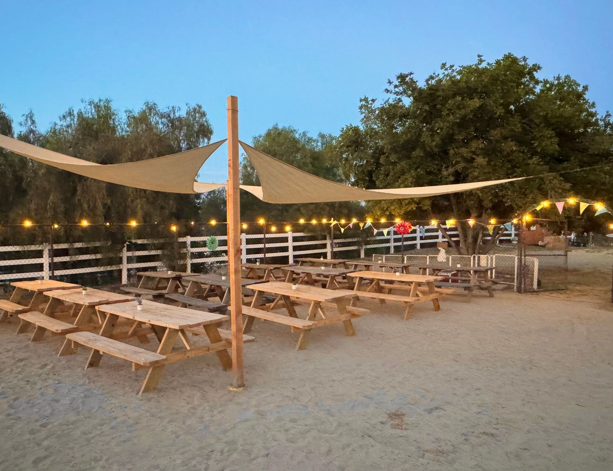
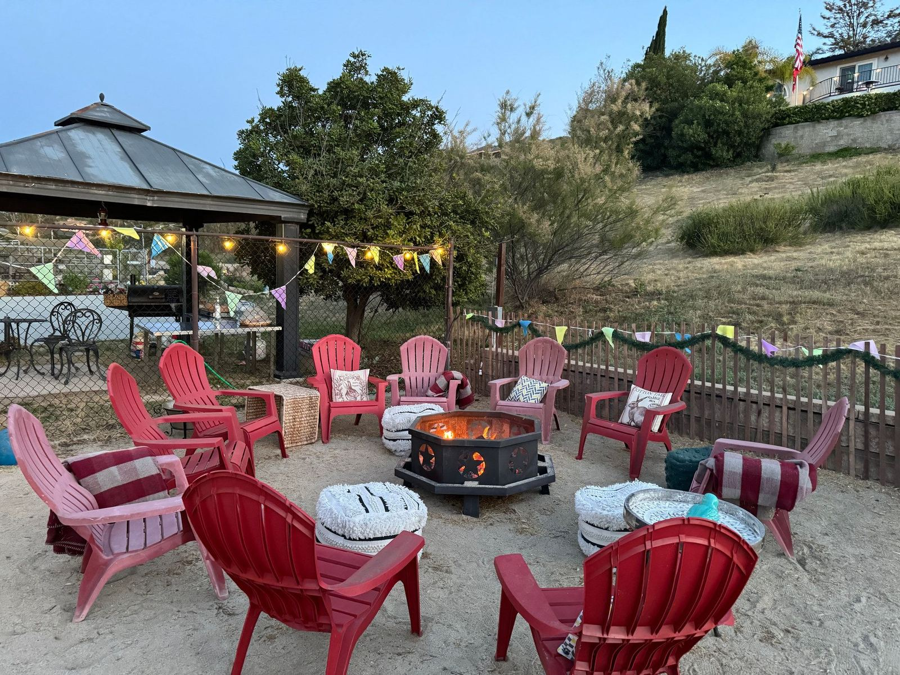
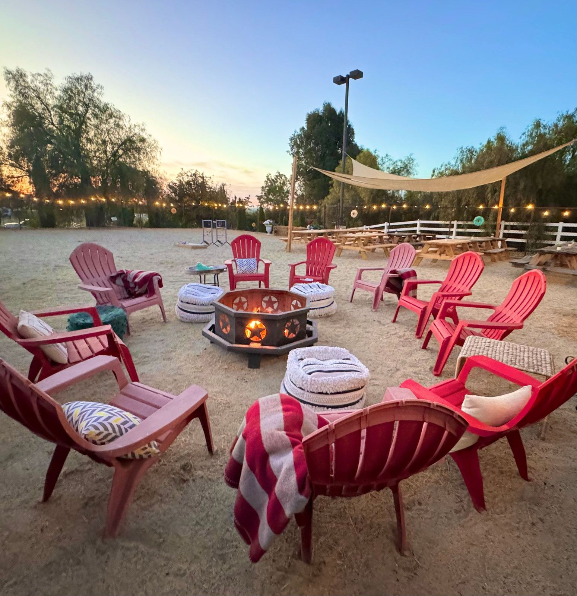
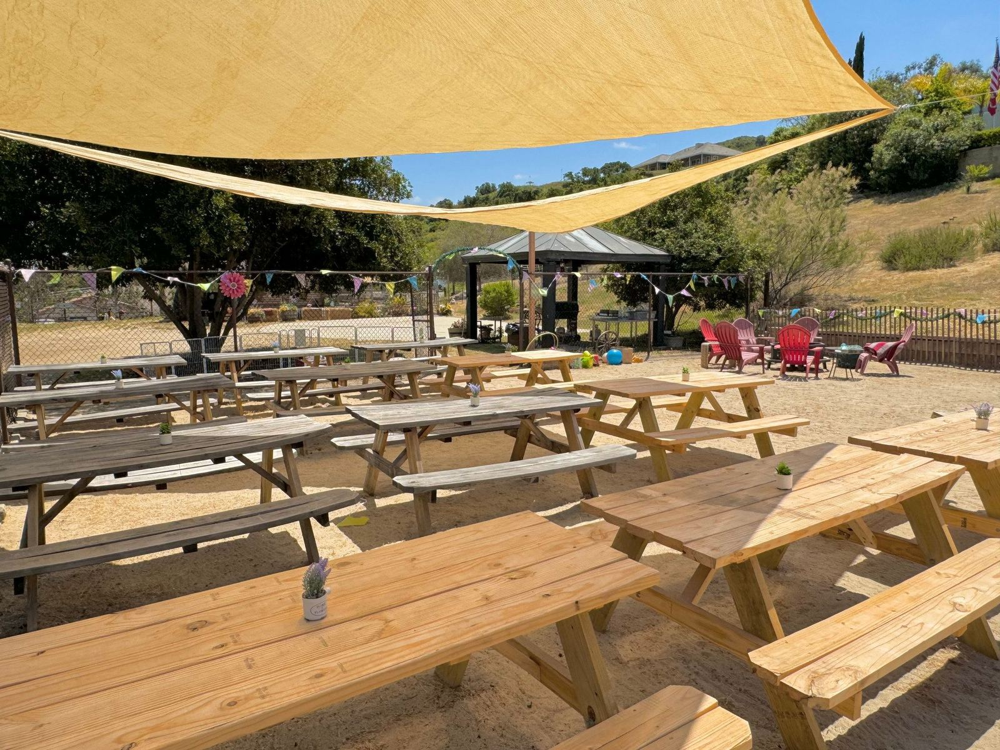
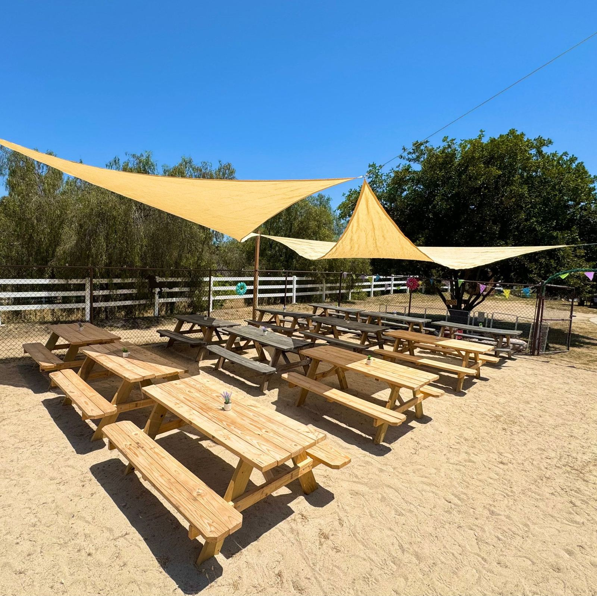

# Sandpit Photos

Rustic venue by the Animal Barn and Lower Banquet area: An 80 ft. X 45 ft sand pit that features tables and benches for a party of 100+, a large fire ring with chairs, games and toys, and can be decorated for any occasion and photo backdrops.

Two photo backdrops featuring bales of hay and farm props and decor. 

The adjacent concrete pad offers a fun, open air dance floor for the perfect, rustic feel under bistro lights and the stars.

---

