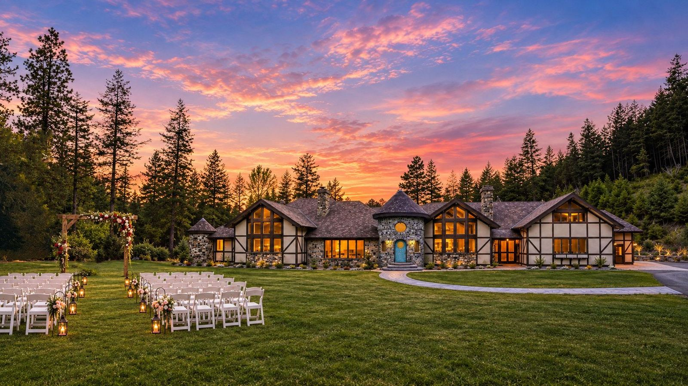
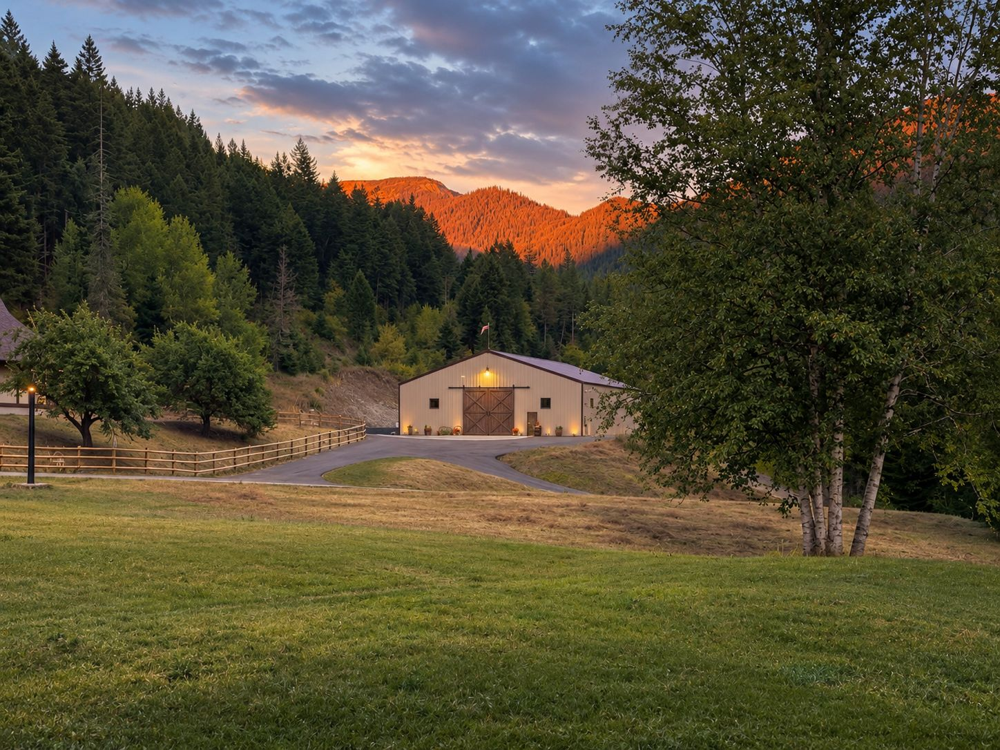
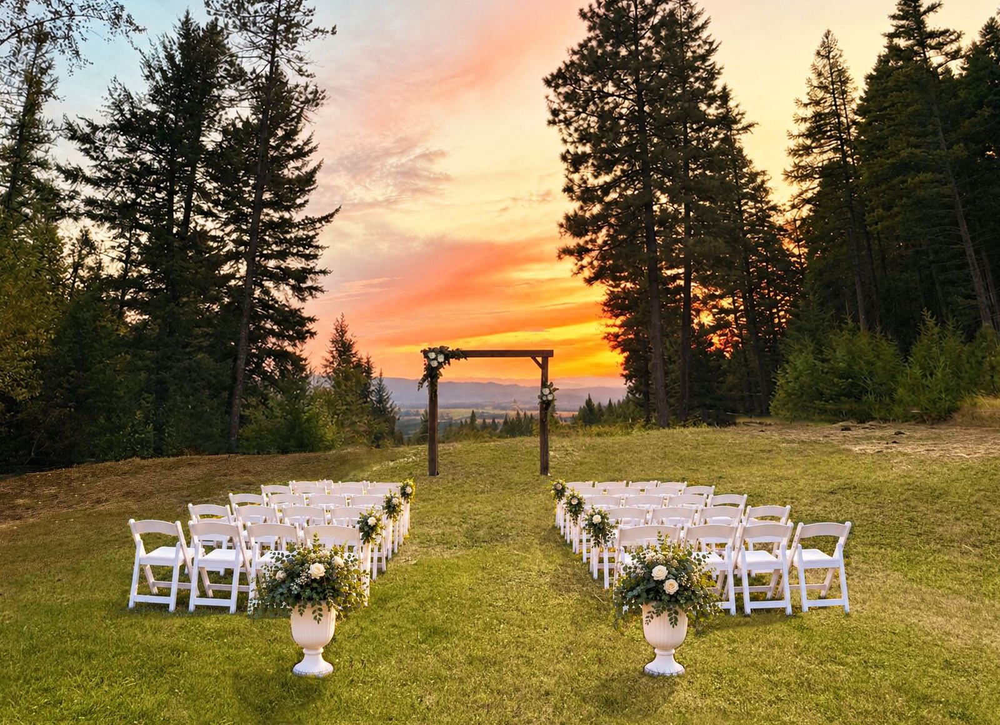
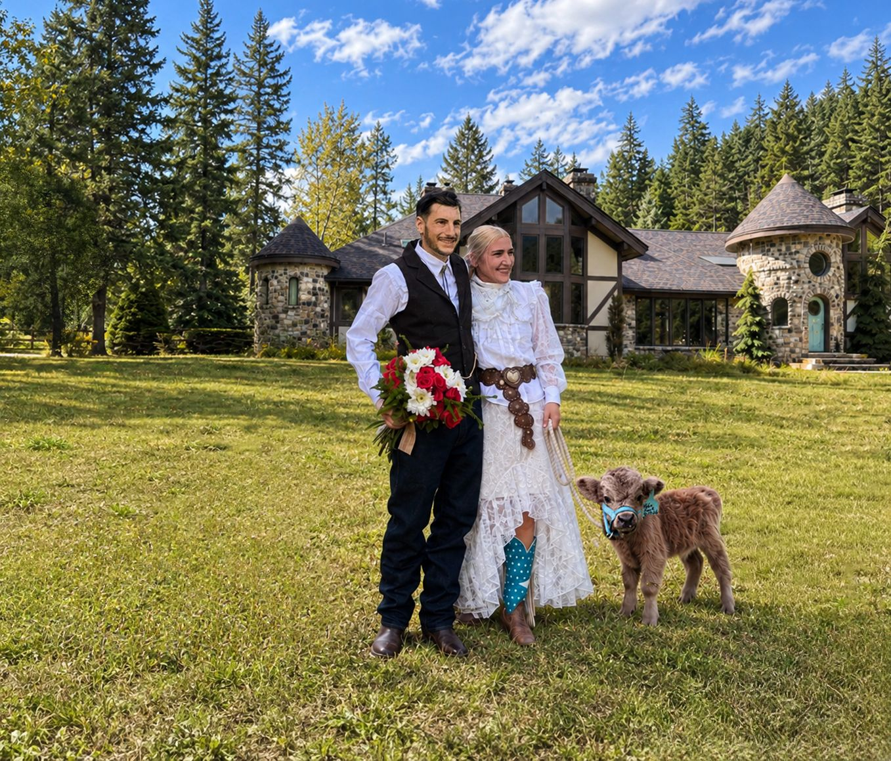
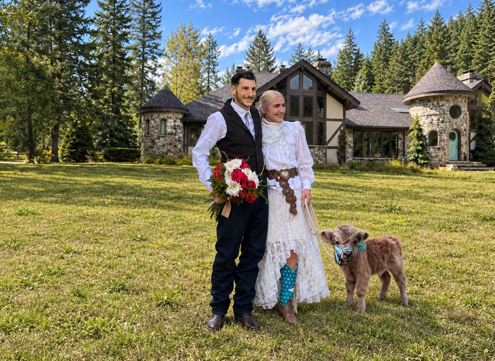
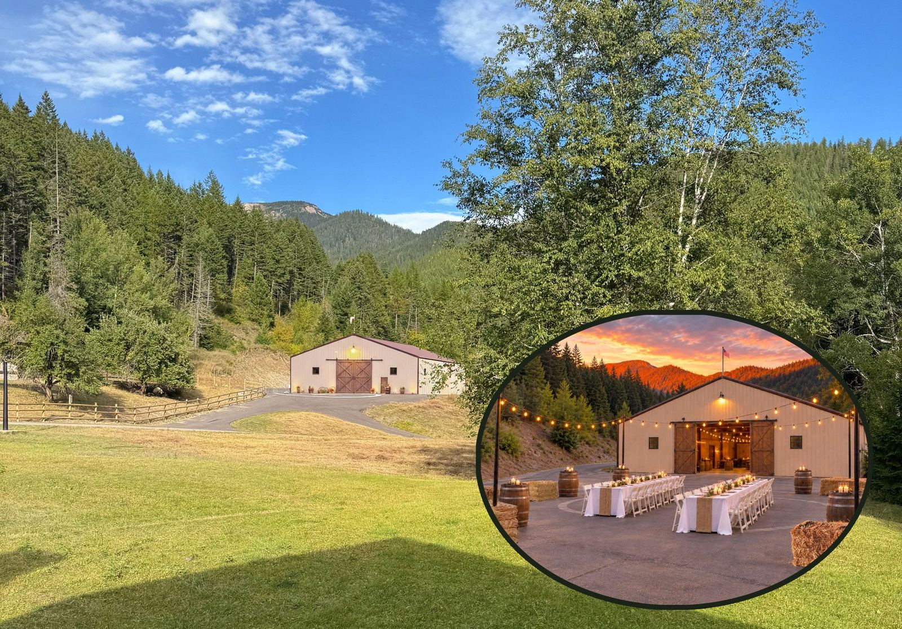
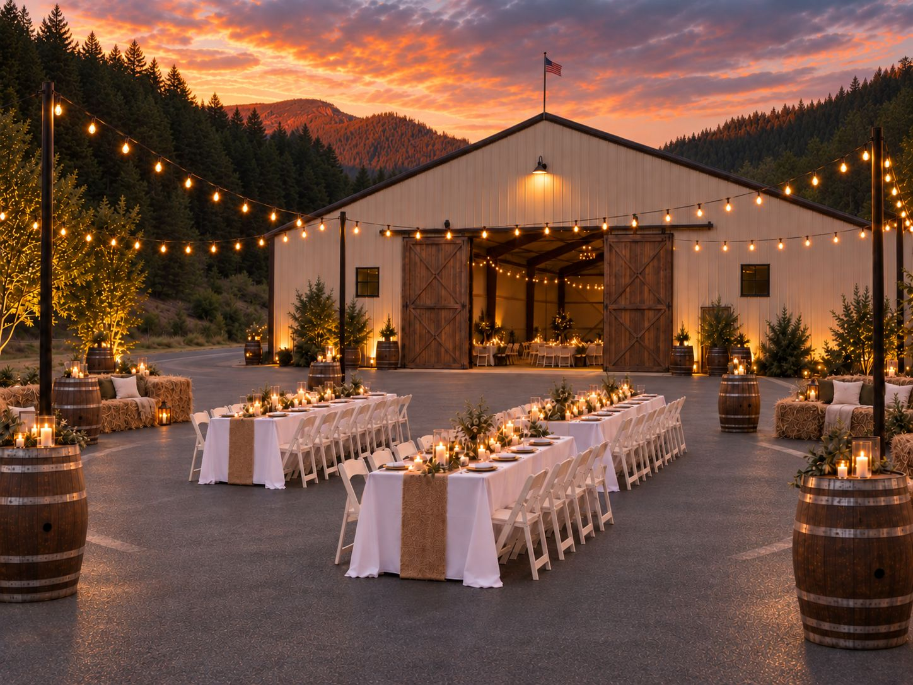
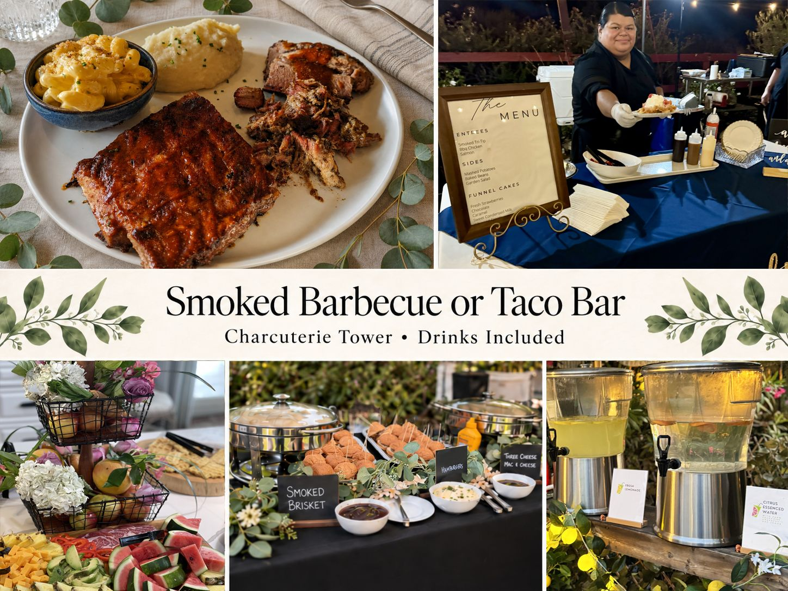
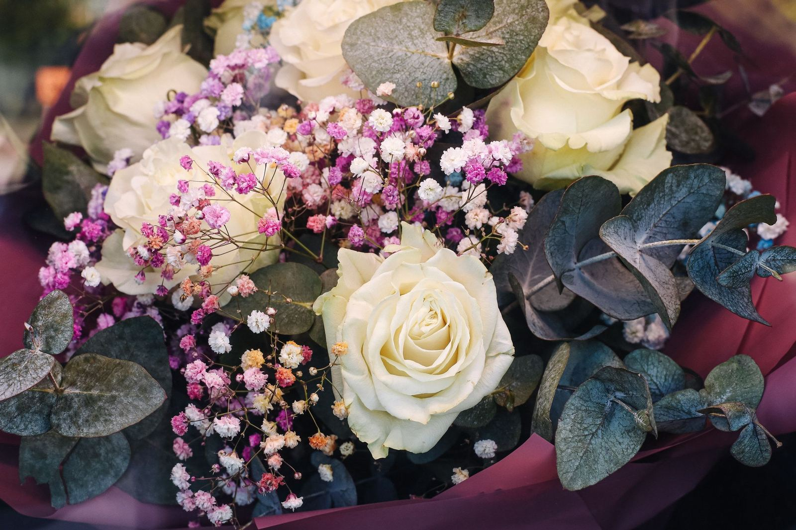

# A Montana Fairytale Wedding Village

Pictured: Fairy Meadows Ceremony Area with optional Castle Chalet or mountain view orientation; wooden padded chair inventory, and our signature ceremony arch 7 ft. 3’’ high 7 ft. wide solid wood

Set on over 21 acres in the foothills of the Rocky Mountains, Howe Ranch feels wonderfully secluded just 20+ minutes from Glacier Park International Airport, and within easy reach of Kalispell, Whitefish, Bigfork, Flathead Lake, the best of the Flathead Valley, and Glacier National Park.

Surrounded by forest, valley views, and mountain peaks, with Brown Creek running through it, our storybook property offers multiple ceremony settings — from sweeping lawns and open views to intimate spaces framed by towering trees.

Beyond the scenery, couples enjoy exclusive use of our 60 ft X 80 ft dedicated all weather event barn and thoughtfully curated wedding spaces, personalized for each celebration with our extensive collection of furnishings, banquet ware, décor, props, and styled pieces — creating a storybook setting that feels polished, cohesive, and entirely their own [(albums of Howe Ranch wedding settings in Wildomar)](/photos)

And then there are the animals — the heart of Howe Ranch. Our beloved micro miniature Highland cows, and other gentle, trained animals invite guests to slow down, connect, laugh, and be fully present in a way that becomes one of the most memorable parts of the entire celebration.

### Two Beautiful Ways to Celebrate at Howe Ranch

Whether you envision a lavish wedding weekend surrounded by everyone you love or a smaller, intimate gathering, Howe Ranch offers thoughtfully curated private celebrations in our storybook Montana estate.

◆ The Signature Wedding Experience ◆

Our complete wedding celebration, featuring extended private estate access, beautifully styled ceremony and reception settings, full banquet dining, beloved ranch animal encounters, and overnight accommodations for your closest loved ones.

Saturday celebrations · Personalized pricing

Scroll down for details and a personalized quote.

◆ The Intimate Wedding Experience ◆

A charming, beautifully curated ceremony and/or reception for up to 50 people. Enjoy private estate access, coordinated styling, your choice of a hosted taco bar or grazing experience, refreshing beverages, and the magic of our miniature Highland cows and barn friends.

Select Thursdays, Fridays & Sundays (Not Saturdays)· Six-hour celebration · Flat-rate pricing

[Explore Our Intimate Weddings →](/microwedding)

How Our Storybook Packages Work:

Our Storybook Wedding Packages apply to all wedding-related celebrations held at Howe Ranch, including elopements, ceremony-only weddings, micro weddings, vow renewals, reception-only celebrations, and full ceremony-and-reception weddings. Our pricing is not based solely on the amount of time guests spend on the property or on which portions of the wedding take place here. Even a ceremony-only celebration requires extensive property and grounds preparation, venue setup, staffing, animal preparation and handling, guest logistics, cleanup, and the many operational expenses involved in preparing Howe Ranch for a private wedding celebration. For this reason, we do not offer a separate “ceremony stop,” hourly venue rental, or reduced-rate option for couples who have arranged lodging, receptions, or other portions of their wedding elsewhere. Any wedding ceremony or wedding-related gathering held at Howe Ranch is reserved through one of our Storybook Wedding Packages.

---

## Your Own Private Storybook World

No traffic. No neighboring banquet rooms. No public crowds passing through. Just your guests, the mountains, the animals, and an entire storybook property reserved around the experience you came here to create.

Pictured: 60 ft X 80 ft heated Grand Hall, aged wine barrels, Hash Mountain in the background

---

## Old-World Hospitality — Proudly Inclusive

Howe Ranch is a veteran- and LGBT-owned and operated animal farm built around personal, heartfelt hospitality. What we are known for most is making every guest feel seen, welcomed, and genuinely cared for — while doing everything we can to make each celebration feel exceptionally special.

Pictured: Valley View Ceremony Spot, wooden padded chair inventory, and our signature ceremony arch 7 ft. 3’’ high 7 ft. wide solid wood; 16 ft. jute rug x 3

[Property Photos](https://photos.app.goo.gl/PSbQaejBe4Uhobcc6)

---

## Welcome to the Fairytale Village

From the moment you arrive, your wedding unfolds as a fully hosted experience throughout Howe Ranch’s Fairytale Village — home to the Stable Chalet and stables, Grand Hall Event Barn, Castle Chalet with the North Wing guest space, and the Sugar Plum Lounge.

While the wedding party prepares in their private spaces, arriving guests are welcomed by the Howe Ranch team into the Sugar Plum Lounge and surrounding village, where they can mingle, enjoy refreshments, explore beautiful photo spots, and spend time with our miniature Highland cattle and other ranch animals before the ceremony begins.

Throughout your stay, our family and event team remain on site to welcome, guide, and support your guests as the program moves naturally from one thoughtfully prepared space to the next.

Pictured: The Howes with Finnegan of Belmont (Highland bull)

[Site Map](/)

---

## Ceremony, Your Way

Choose the setting that feels most like you. 

Castle Chalet Ceremony 

Celebrate with the chalet and Fairytale Village creating a striking architectural backdrop. 

Mountain View Ceremony 

Exchange vows framed by Montana's mountains and changing skies. 

Valley View Ceremony 

A romantic open landscape with sweeping valley views and spectacular sunsets.

Each setting can be thoughtfully styled using Howe Ranch furnishings, ceremony pieces, décor, and props.

---

## The Grand Hall

A beautiful four-season reception venue with a 60 X 80 ft footprint.

Our dedicated event barn, the "Grand Hall," gives your celebration a comfortable indoor home in every season.

The space can be curated for dinner, dancing, speeches, cake, entertainment, and other elements, with:

- Reception tables and chairs
- Styled furnishings, and décor
- DJ and entertainment area
- Sound capabilities
- Catering and service areas
- Dance floor configuration (concrete footing)
- Café lighting and event lighting
- Custom reception layouts

Rather than asking couples to source and assemble an entire venue from scratch, we curate the property around the celebration.

[Wedding Photos](https://photos.app.goo.gl/gDQQw6RRFypBc7TB8)(from our old location with our signature style - Wedding assets and props represent our current inventory)

---

### Furnishings, Décor & Styling Included

One of the biggest differences at Howe Ranch is how much is already here and the love we put into making every detail of your celebration truly special.

Your package includes access to our extensive collection of: 

Wedding furniture • tables • chairs • ceremony pieces • props • lounge furnishings • signage • linens • serving pieces • decorative accents • styled displays • photo backdrops

Our team uses those resources to create a cohesive celebration around your chosen look and the spaces you will be using.

---

### Catering Is Included

Your wedding package includes dinner for your guests through our premier catering partner, Smoked Delights, or local alternative.

Choose from options such as:

Smoked BBQ

A generous Montana-style barbecue dinner with selected meats, sides, and accompaniments.

Festive Taco Bar 

A plentiful taco-bar experience with multiple meats, sides, toppings, and fixings.

Other menus from our approved catering partners may also be available.

No Outside Catering

To maintain food quality, service standards, property logistics, and a seamless guest experience, outside caterers and food trucks are not permitted.

Select specialty wedding professionals—such as your photographer, videographer, photo booth provider, officiant, or similar services—may be welcomed with prior approval.

---

### Included With Every Celebration

- Private use of ceremony and reception spaces
- Choice of ceremony settings
- Fairytale Village & Sugar Plum Lounge
- Four-season Event Barn reception
- Tables, chairs & event furnishings
- Curated décor & styling resources (included decor for banquet and service tables and arch)
- Setup & breakdown
- Dinner catering
- Curated animal encounters & photography opportunities
- On-site wedding/event staff
- Guest parking
- Optional overnight accommodations
- Access to approved specialty wedding vendors
- Non-alcoholic drinks
- Access to high value add-ons and top regional vendors

---

### Build Your Montana Dream Wedding

<a class="button" href="https://thehoweranchregistration.com/weddings">Instant Wedding Quote</a>

