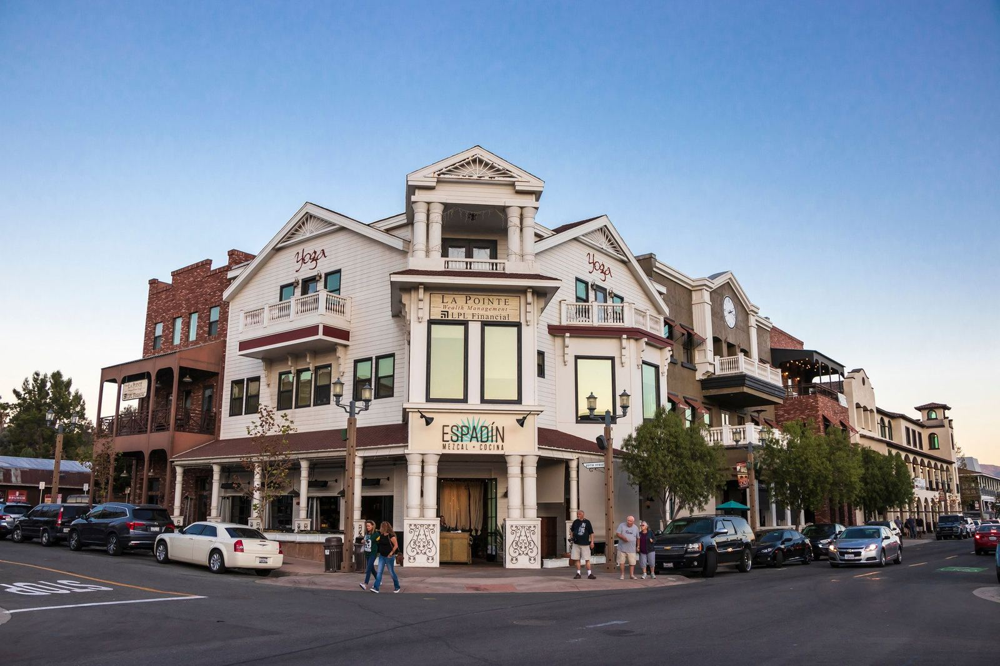
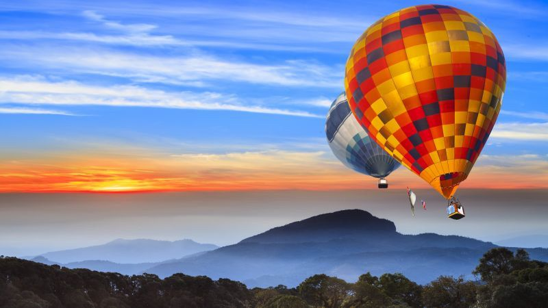
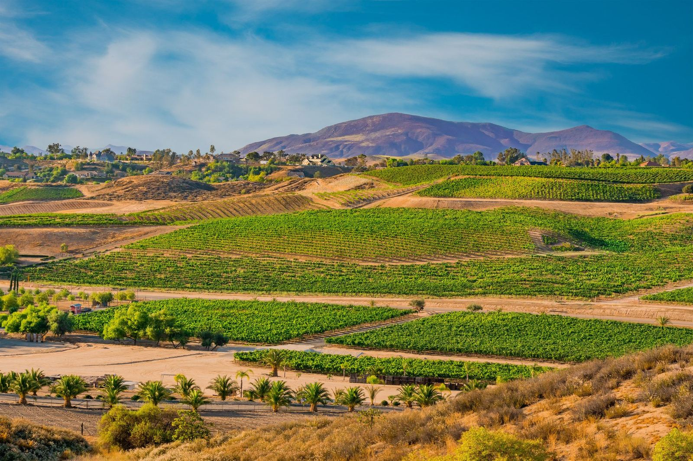
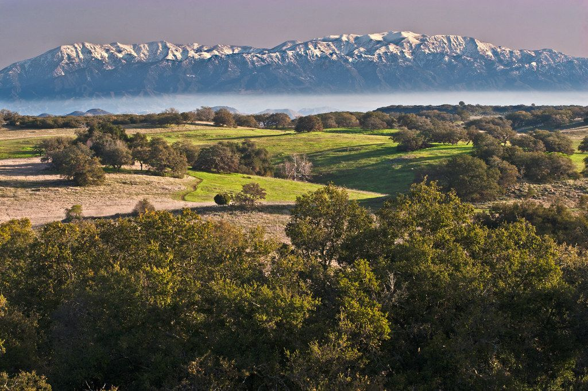
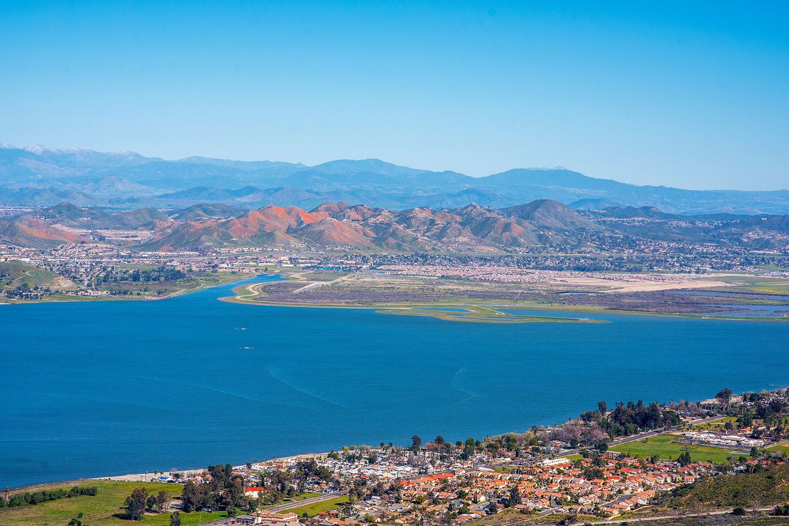

# Adventures Near Howe Ranch

---

### OLD TOWN TEMECULA

Enjoy a memorable day exploring California's famous wine culture in the beautiful Temecula Valley. Discover wineries of all sizes that serve up award winning wines, hospitality, wine knowledge, and stunning vineyard views. Guests typically enjoy an artisan inspired lunch in the stunning scenery of the rolling hills of Temecula. Per recommendations from guests, we include the Somerset Winery in this visitor guide. 

ula Old Town, which is our Wild West style capitol of the area. Old Town Temecula is a historic district, where the past meets the present in a charming blend of shops, restaurants, and attractions. The town was founded in the 1880s, when the railroad brought commerce and travelers to the Temecula Valley, a fertile region known for its wine and agriculture. Visitors can explore the horseshoe-shaped town square, where they can admire the preserved buildings, browse the antique dealers, and learn about the local history and culture. 

Old Town Temecula also offers a variety of entertainment options, from outdoor escape rooms and ghost tours, to live music and street art festivals, to classic car shows and parades. 

For food and drink lovers, Old Town Temecula has something for everyone, from cozy pubs and grills, to trendy breweries and wineries, to diverse cuisines and flavors. Our favorite venues are the Beer Garden, which features live music weekly, the Texas Lil's Cocktails & Dining for an overall fabulous menu, and Mad Madeline's Grill for the best diner burger.

---

### HOT AIR BALLOON RIDES

Guests love going on hot air balloons for a bird’s view of Temecula Valley and the Santa Ana Mountains, which are by our ranch. We recommend California Dreamin’ Balloon Adventures, because the company has provided outstanding customer service to our guests.

---

### EXPLORE WINE COUNTRY

Enjoy a memorable day exploring California's famous wine culture in the beautiful Temecula Valley. Discover wineries of all sizes that serve up award winning wines, hospitality, wine knowledge, and stunning vineyard views. Guests typically enjoy an artisan inspired lunch in the stunning scenery of the rolling hills of Temecula. Per recommendations from guests, we include the Somerset Winery in this visitor guide.

---

### BIKING

The area boasts some of Southern California's most popular mountain trails with ideal conditions – The Plateau and North of Greer Ranch trails, from beginner to black diamond. To get to the trails off the Santa Ana Plateau, keep following Clinton Keith (instead of turning right towards Wildomar Estates). North of Greer Ranch you park off of 215 on the west side, exit Scott Rd to access Distortion Upper, Climb to the Towers, Jumping Mouse. Recommending Trailfork map and MTB Project.

---

### HIKING

The Santa Rosa Plateau Ecological Preserve, just west of the property, is a breathtaking natural sanctuary renowned for its diverse ecosystem. Nestled in the heart of Southern California, this preserve offers a tapestry of native grasslands, oak woodlands, coastal sage scrub, vernal pools, and tenajas. Nature enthusiasts and hikers alike will be captivated by the wealth of experiences it offers. 

Explore a network of nature hikes that wind through this ecological gem. Whether you prefer a leisurely stroll or a more challenging trek, there's something for everyone. As you traverse the terrain, keep your eyes peeled for the vibrant array of bird species that call this preserve home. The Tenaja Falls are a destination most of our Hipcamp visitors have visited. Take a refreshing dip after the hike.

Bird lovers will delight in the opportunity to spot both common and rare avian residents. But it's not just the birds that make this place special. Hikers might also cross paths with elusive mountain lions, graceful deer, and bobcats, adding an element of wildlife intrigue to your adventure. With hikes ranging from short and easy to longer and more challenging, the Santa Rosa Plateau Ecological Preserve beckons all to immerse themselves in the wonders of its diverse landscapes and abundant wildlife. Explore other hikes in the area on AllTrails.

---

### BOATING & FISHING

Just a short 10-minute drive from Howe Ranch, you'll find Lake Elsinore, the largest natural freshwater lake in Southern California, spanning 3,000 acres. This popular destination offers a variety of water activities for those seeking a relaxed, nature-inspired experience, including fishing, kayaking, wind surfing, boating, wakeboarding, water skiing, and jet skiing. 
Lake Elsinore is the perfect destination for a memorable family fishing day. This picturesque lake is regularly stocked with a variety of fish, including bass, catfish, hybrid striped bass, and crappie, ensuring plenty of opportunities for anglers of all ages to have a great time. Lake Elsinore offers a vast and beautiful setting for your fishing adventure. The lake's fish populations are carefully managed to enhance your fishing experience.

---

### OTHER FUN THINGS TO EXPLORE

WILDLIFE TO WATCH

AllTrails helps you explore the most popular bird watching trails in Santa Rosa Plateau Ecological Reserve with hand-curated trail maps and driving directions as well as detailed reviews and photos from hikers, campers and nature lovers. On our ranch you might see our resident barn owl, a bobcat, mountain lions, our resident toads, and in the adjacent wilderness a pack of coyotes.

OHV

About 20 north from Howe Ranch you can access the Wildomar OHV Park, a 360 acre OHV area contains over 8 miles of trails and is perfect for all experience levels, or those looking for single track trails.

The area is also considered part of the Motocross Mecca of the U.S., with Lake Elsinore Motorsports Park just 7 minutes from the ranch.

HORSEBACK RIDING

Wildomar Estates is one of few equestrian enclaves of Southern California. Take a horseback riding lesson at a local equestrian center, or discover nature by trail riding through a local guide and stable such as a Trail to Remember. They offer a unique trail experience to small groups from 2 - 4.

MULIGAN'S FAMILY FUN CENTER

Just minutes away is a Western themed family amusement fun center with a variety of things to do for everyone, from go-karts to laser tag, you can have a blast! Our favorite activity is mini golf, which is a really nice course.

SHOPPING

Guests love bargain hunting at the antique stores in Old Town Temecula! If you enjoy strolling through a beautiful outdoor mall, visiting the P[romenade Temecula](http://www.promenadetemecula.com) is a must. Another popular destination for the savvy shopper is the [Outlets at Lake Elsinore](http://www.outletsatlakeelsinore.com) mall.

